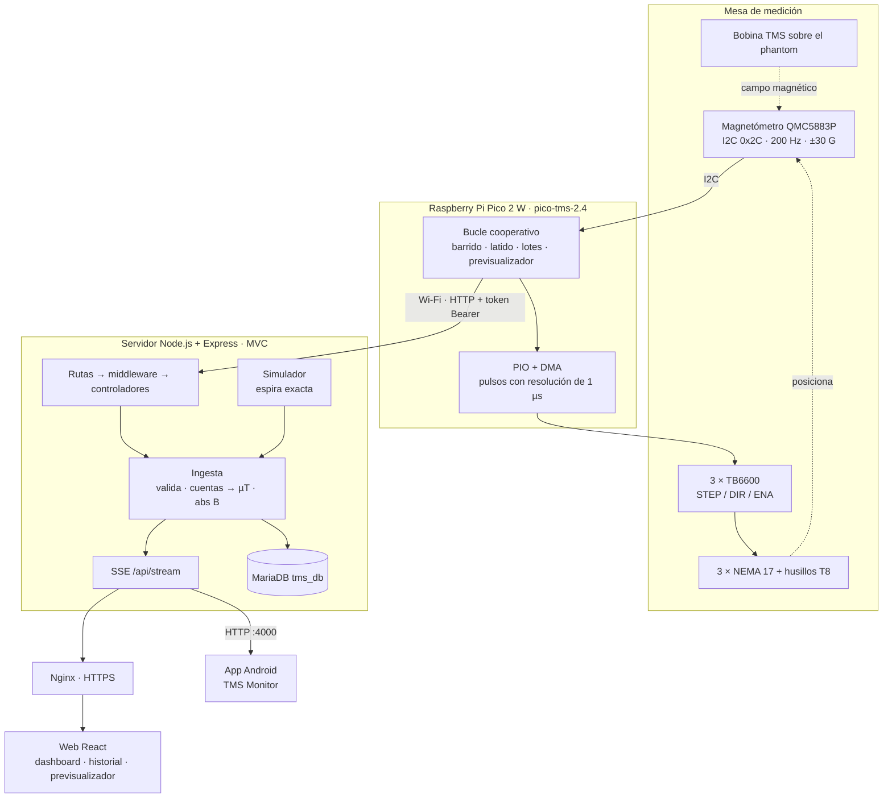

# 01 · Arquitectura general

Bloques del sistema y por dónde viajan los datos. La Pico mide y mueve la mesa; el servidor valida, convierte, guarda y difunde; la web y la app solo dibujan lo que llega por SSE. El simulador entra por la misma ingesta que la Pico, así que los datos simulados y reales siguen el mismo camino (y se distinguen por `origen`).

**Fuente:** `firmware/main.py`, `server/app.js`, `server/services/ingesta.js`, `server/services/tiempoReal.js`; CLAUDE.md §3.

