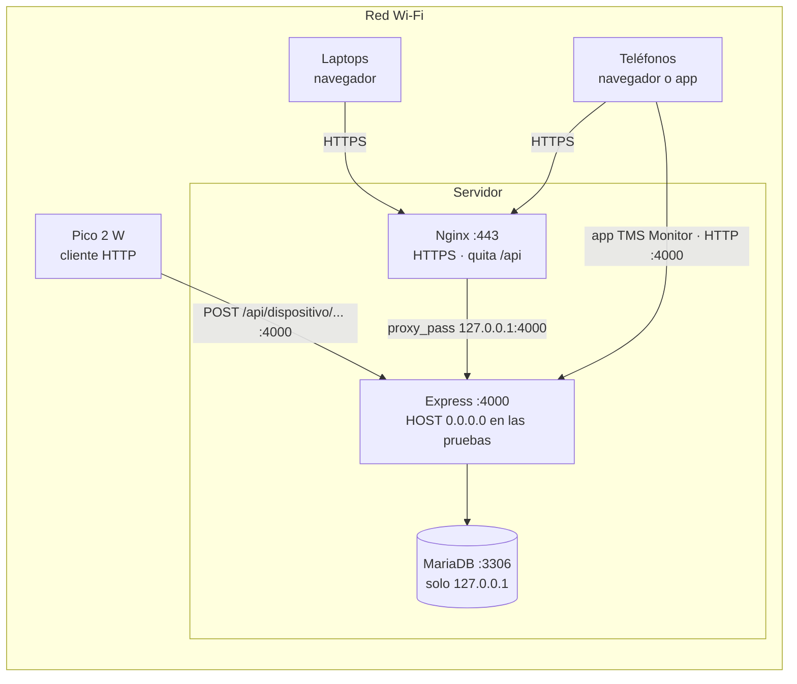

# 02 · Despliegue

Dónde corre cada pieza y por qué puerto se habla. La red es la Wi-Fi del laboratorio (o el hotspot de un iPhone). La Pico y la app móvil van directo al puerto 4000 de Express; los navegadores entran por Nginx (HTTPS), que quita el prefijo `/api`. Hoy el servidor es la laptop de desarrollo; la Raspberry Pi 5 está prevista y, al instalarla, hay que decidir si el puerto 4000 queda abierto a la red (lo necesitan la Pico y la app).

**Fuente:** `nginx/tms.conf` (no se toca), `server/.env.example`, `COMANDOS.md`; CLAUDE.md §0.5, §0.6 y §2.

