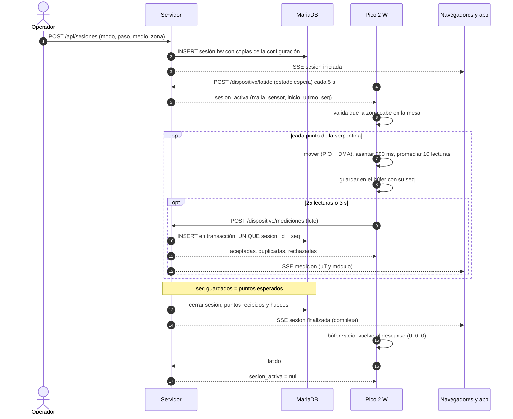

# 03 · Secuencia de una medición completa

De que el operador pulsa «Iniciar medición» a que la mesa vuelve al descanso. La Pico se entera de la sesión por el latido (no hay otra vía de entrada al microcontrolador). Las lecturas salen en lotes mientras la mesa sigue moviéndose. El servidor cierra la sesión solo cuando tiene todos los `seq` esperados.

**Fuente:** `server/controllers/mediciones.controller.js`, `server/controllers/dispositivo.controller.js`, `server/services/ingesta.js`, `firmware/main.py`, `firmware/barrido.py`, `firmware/cliente.py`.

