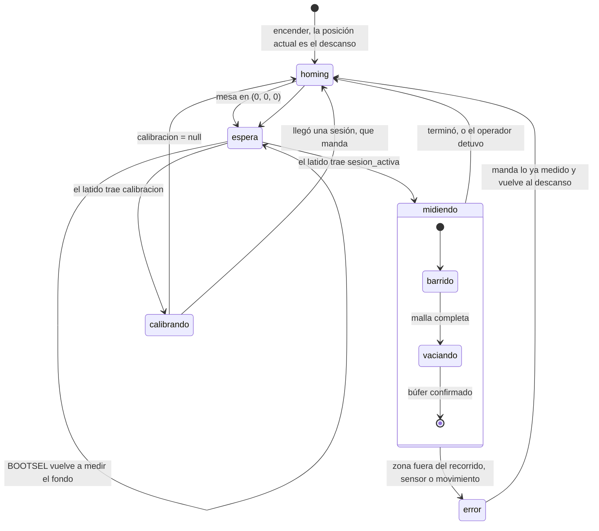

# 04 · Máquina de estados de la Pico

Estados que la Pico informa en cada latido (`espera`, `homing`, `midiendo`, `calibrando`, `error`). Internamente, «midiendo» agrupa las fases `barrido` y `vaciando` (mandar lo que queda en el búfer) y «homing» agrupa el arranque y el regreso al descanso (`cierre`). Un 401 (token inválido) detiene todo desde cualquier estado y manda la mesa al descanso.

**Fuente:** `firmware/main.py` (`Controlador.estado_pico`, `avanzar_tarea`, `fallar`, `abortar_sesion`, `revisar_calibracion`).

