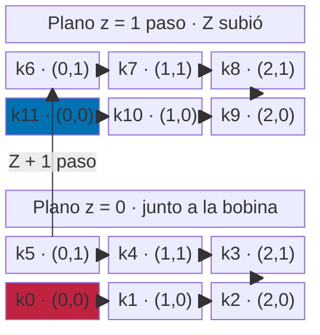

# 05 · Recorrido en serpentina (3 × 2 puntos, 2 planos)

El vector de prueba del contrato: `nx = 3`, `ny = 2`, dos planos, k = 0…11, en índices (ix, iy); en cada plano, la fila de abajo es iy = 0, y el plano de arriba es el más alejado de la bobina. Rojo: primer punto; azul: último. Entre dos puntos seguidos solo cambia un índice en ±1: la mesa nunca regresa en vacío. Z empieza junto a la bobina y **sube** un paso por plano; el plano siguiente arranca donde quedó la mesa, así que Y también va y viene. Con una lectura por punto, `seq = k + 1`.

**Fuente:** `firmware/barrido.py` (contrato), `server/services/geometria.js` (`indicesDeSerpentina`), `docs/firmware-pico-w.md` §7 (vector de prueba), prueba `test_mismo_conjunto_que_el_servidor`.

