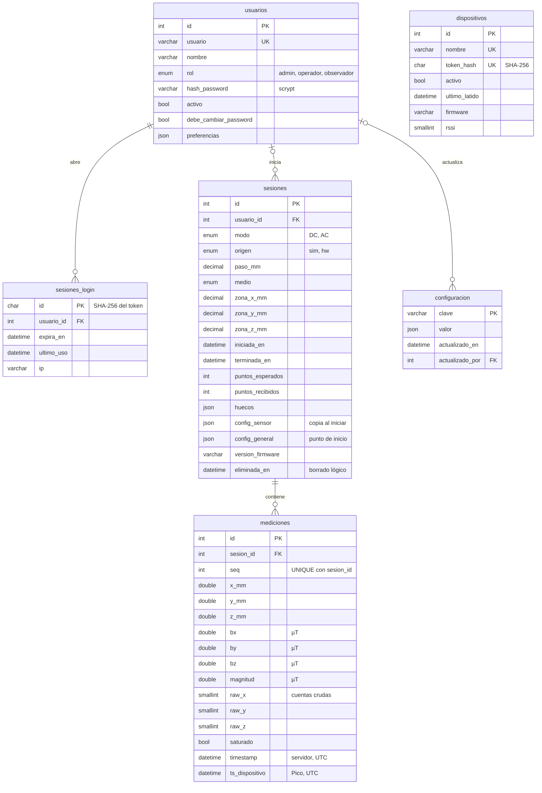

# 06 · Modelo entidad-relación

Las seis tablas de `tms_db` (esquema de la migración 009). `mediciones` cuelga de `sesiones` con borrado en cascada y la restricción `UNIQUE(sesion_id, seq)`, que hace idempotentes los lotes de la Pico. `dispositivos` no tiene llaves foráneas: la Pico se autentica con su token (se guarda su SHA-256). Posiciones en mm del sistema, campo en µT, horas en UTC.

**Fuente:** `server/setup_db.sql`, `server/migrations/002` a `009`.

