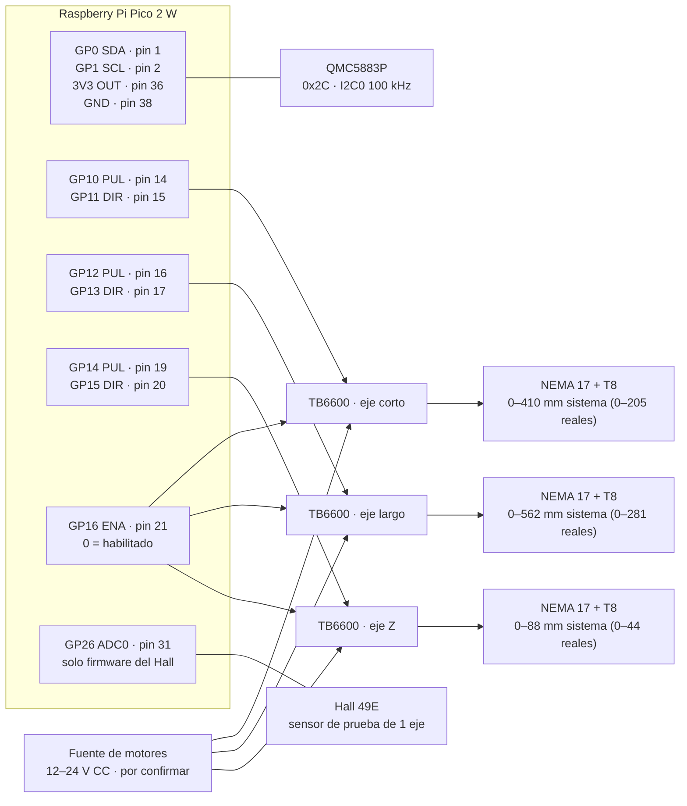

# 07 · Conexiones de hardware

Pines de la Pico 2 W según `firmware/config.py` (GPIO) y el instructivo (pin físico). Los TB6600 tienen entradas con optoacoplador; ENA es común a los tres y en 0 los habilita. Recorridos en mm del sistema y, entre paréntesis, en mm reales (÷ 2). La fuente de los motores, cómo se alimenta la Pico y cómo quedó el recableado de tierras del *shield* están **por confirmar**.

**Fuente:** `firmware/config.py`, `firmware_hall_1d/config.py`, `docs/instructivo-calibracion-y-conexiones.md` (pines físicos).

