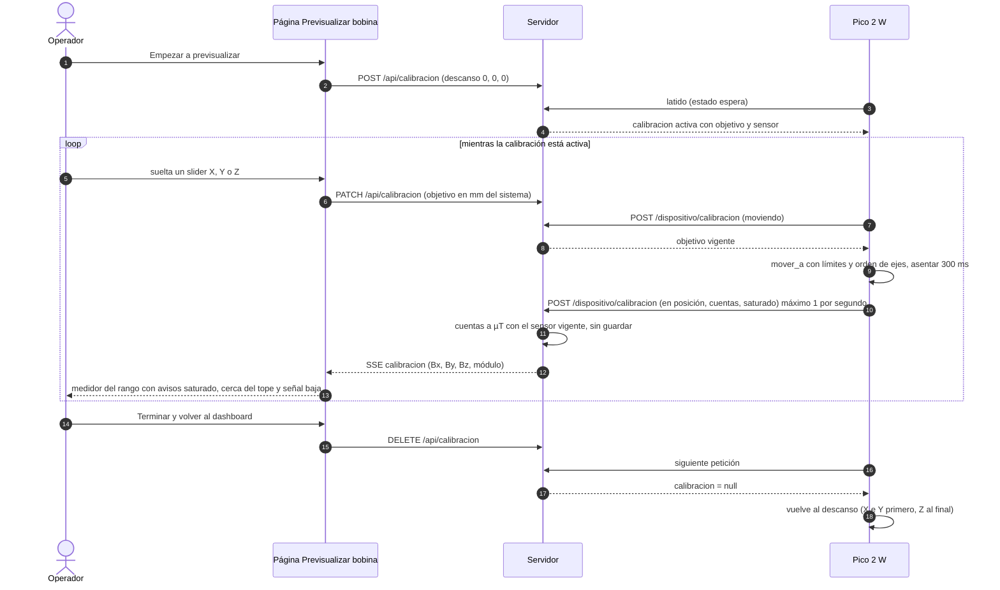

# 08 · Flujo del previsualizador de la bobina

Para ajustar la corriente de la bobina antes de medir: el operador mueve un slider, la mesa va a ese punto y la página muestra el campo en vivo y cuánto del rango del sensor se está usando. Nada se guarda en la base ni se crean sesiones. La Pico manda como mucho una petición por segundo (con 150 ms se apagaba). La página trabaja en mm reales y manda mm del sistema (× 2).

**Fuente:** `firmware/calibracion.py`, `server/services/calibracion.js`, `server/controllers/calibracion.controller.js`, `frontend/src/pages/CalibracionPage.jsx`; CLAUDE.md §0.11.

