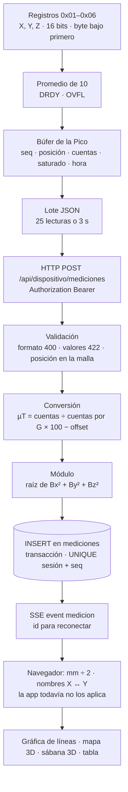

# 09 · El viaje de una lectura

Qué le pasa a un número desde el registro del QMC5883P hasta la gráfica. La Pico manda **cuentas crudas** (el dato tal como lo midió el chip); la conversión a µT se hace en el servidor con la copia de la configuración del sensor guardada con la sesión, así una sesión se puede reinterpretar después. Ejemplo con 30 G: 1000 cuentas/G, 1 cuenta = 0,1 µT.

**Fuente:** `firmware/sensor.py`, `firmware/cliente.py`, `server/middleware/validar.js`, `server/services/conversionSensor.js`, `server/services/ingesta.js`, `server/services/tiempoReal.js`, `frontend/src/utils/escalaMM.js`.

