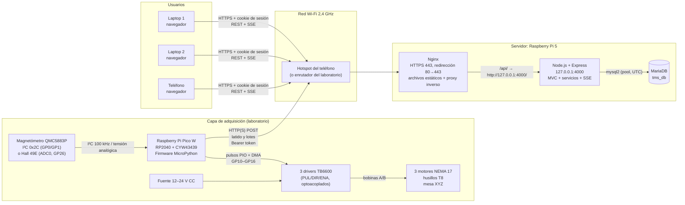
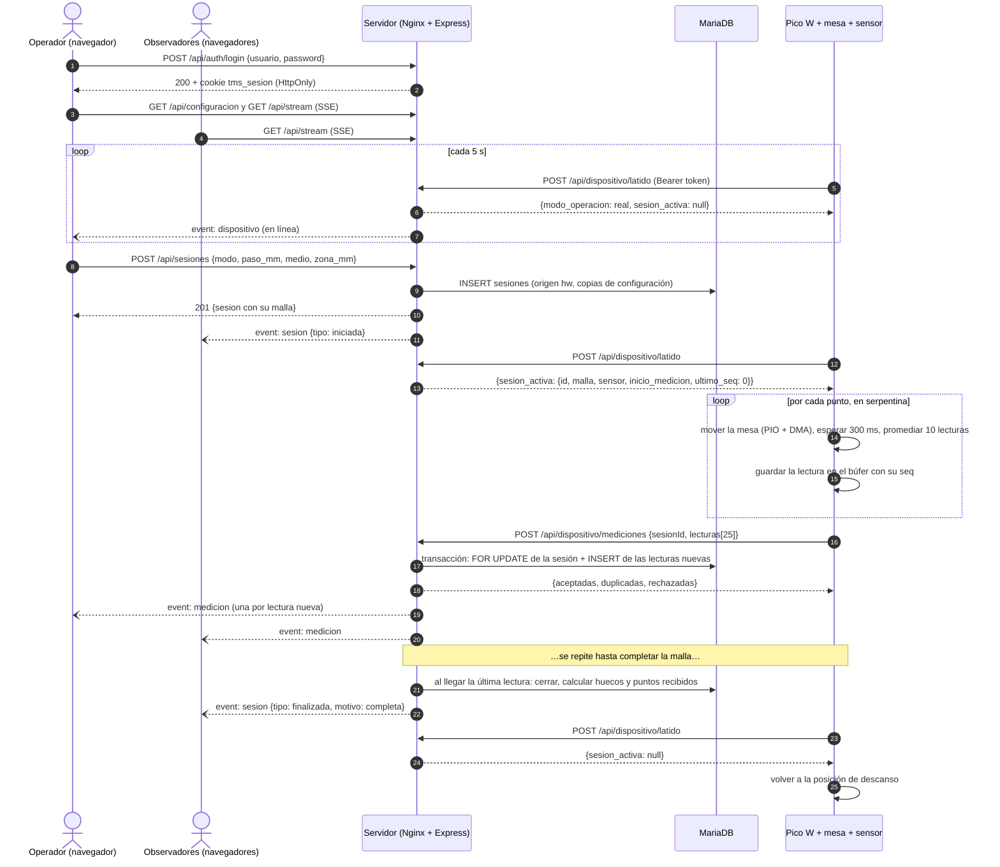
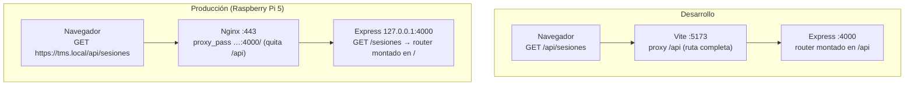

# 02 — Arquitectura general

Este documento describe la arquitectura completa del SAVD: cómo se conectan el sensor, la Raspberry Pi Pico W, la red, el servidor en la Raspberry Pi 5 y los navegadores de los usuarios; qué modelos y patrones de diseño se aplicaron y por qué; cómo recorre el sistema una medición de punta a punta, y por qué el servidor publica su API en dos prefijos de ruta.

---

## 1. Diagrama de bloques del sistema

**Figura 2.1. Diagrama de bloques de todo el sistema.** El diagrama muestra las cuatro capas (adquisición, red, servidor e interfaz) y los enlaces entre ellas. Las flechas indican el sentido en que viajan los datos de medición; el control (qué sesión medir) también fluye del servidor a la Pico, pero siempre como respuesta a una petición de la Pico, nunca por iniciativa del servidor.

En producción, todo el tráfico externo entra por Nginx en el puerto 443; el proceso de Node.js solo escucha en la interfaz local (127.0.0.1), de modo que nadie en la red puede hablar con él directamente. En desarrollo, el servidor de Vite (puerto 5173) sirve la interfaz y reenvía `/api` al backend; para que la Pico W alcance un backend que corre en una laptop, este se arranca escuchando en todas las interfaces (variable `HOST=0.0.0.0`) y la Pico lo llama directamente por HTTP en el puerto 4000.

---

## 2. Modelos y patrones de arquitectura

| Patrón | Dónde se aplica | Por qué |
|---|---|---|
| **Cliente-servidor** | Navegadores y Pico W como clientes; la Raspberry Pi 5 como servidor central | Un único punto de verdad para los datos y la configuración; los clientes pueden ser heterogéneos (laptops, teléfonos, un microcontrolador). |
| **MVC con capa de servicios** | Backend: rutas → middleware → controladores → modelos, más `services/` | Separa responsabilidades: las rutas solo declaran, el middleware valida y autentica, los controladores traducen a HTTP, los modelos contienen todo el SQL y los servicios la lógica compartida (ingesta, sesiones, simulador, difusión). Facilita las pruebas: la lógica pura vive en módulos que no tocan la base de datos. |
| **Proxy inverso** | Nginx delante de Node.js | Termina HTTPS, sirve los archivos estáticos del dashboard con compresión y caché, añade cabeceras de seguridad y aísla al proceso de Node.js en la interfaz local. |
| **API REST con JSON** | Toda la comunicación de datos y control | Formato universal, legible y fácil de consumir desde React y desde MicroPython. Respuestas uniformes `{ok: true, …}` o `{ok: false, error, errores?}` con códigos HTTP semánticos (400, 401, 403, 404, 409, 410, 422, 429). |
| **Publicación de eventos con Server-Sent Events (SSE)** | `GET /api/stream`: el servidor empuja eventos `medicion`, `sesion`, `configuracion`, `dispositivo` y `resincronizar` | Comunicación unidireccional servidor → navegador sobre HTTP normal (pasa por Nginx sin configuración especial), con reconexión automática del navegador y reenvío de lo perdido mediante identificadores de evento. Se eligió en lugar de WebSocket porque los navegadores solo necesitan recibir, y porque no exige librerías nuevas. |
| **Dispositivo como cliente HTTP con latido (sondeo)** | La Pico W llama al servidor cada 5 s (latido) y envía lotes | El servidor nunca inicia una conexión hacia la Pico: no hace falta abrir puertos ni conocer su IP, lo que funciona en un hotspot que cambia las direcciones. La respuesta al latido le indica a la Pico si hay una sesión que medir y desde qué número de secuencia seguir. |
| **Una sola fuente de datos** | El navegador nunca genera mediciones | Los datos simulados los produce el servidor y los reales la Pico; ambos pasan por el mismo servicio de ingesta. Todos los navegadores ven exactamente lo mismo, quien llega tarde recibe lo ya medido y no hay forma de mezclar datos simulados con reales. |
| **Idempotencia por número de secuencia** | Lotes de la Pico; índice único `(sesion_id, seq)` | La Pico puede reenviar un lote cuantas veces haga falta (por una caída de red) sin duplicar filas. |
| **Copia de la configuración por sesión** | Columnas `config_*` de la tabla `sesiones` | Un cambio de configuración nunca altera una sesión en curso ni la interpretación de una sesión pasada. |
| **Bucle cooperativo con generadores** | Firmware de la Pico W | Permite mover la mesa, leer el sensor, enviar lotes y atender el latido «a la vez» en un microcontrolador, sin hilos. |

---

## 3. Recorrido de una medición de punta a punta

### 3.1 Diagrama de secuencia

**Figura 2.2. Secuencia de una sesión de medición en modo real.** Participan el operador (en un navegador), los demás observadores, el servidor (Nginx y Express se representan juntos), la base de datos y la Pico W con la mesa y el sensor. El diagrama sigue una sesión desde que el operador la inicia hasta que el servidor la cierra sola al recibir todos los puntos.

### 3.2 Descripción en prosa

1. **Inicio de sesión de usuario.** El usuario escribe su nombre y contraseña; el servidor los verifica (scrypt) y responde con una cookie `tms_sesion` que el navegador envía en todas las peticiones siguientes, incluido el canal SSE.
2. **Carga inicial.** El dashboard pide `GET /api/configuracion` (configuración vigente, opciones de los formularios y la sesión abierta, si la hay), abre un único `EventSource` hacia `GET /api/stream` y, al conectarse, pide `GET /api/sesiones/activa` para dibujar lo ya medido.
3. **Latido de la Pico.** Cada 5 s, la Pico W envía su latido con su token. Mientras no hay sesión, el servidor responde `sesion_activa: null`; cada latido se difunde a los navegadores como evento `dispositivo`, que alimenta el indicador «Pico W en línea».
4. **Creación de la sesión.** Un operador o administrador elige velocidad, paso, medio y zona en la barra del panel y confirma en un modal. El servidor valida los parámetros, comprueba que no haya otra sesión abierta (si la hay, responde 409), crea la sesión con `origen` según el modo de operación y guarda copias de la configuración vigente (barrido, sensor, punto de inicio y, en simulación, la de simulación con su semilla). Difunde el evento `sesion {tipo: 'iniciada'}`.
5. **Adquisición.**
   - **En modo real**, la Pico recibe la sesión en su siguiente latido, valida que la zona quepa en la mesa desde el punto de inicio y recorre la malla en serpentina. En cada punto mueve la mesa, espera a que se asiente, promedia diez lecturas del sensor y guarda la lectura en un búfer con su número de secuencia (`seq`). Cada 25 lecturas, o si la más antigua lleva 3 s esperando, envía un lote.
   - **En modo simulación**, el servidor recorre la malla con un temporizador encadenado y calcula el campo de una espira circular más ruido gaussiano.
6. **Ingesta.** Todas las lecturas pasan por `services/ingesta.js`: se valida la posición contra la malla de la sesión, se convierten las cuentas crudas a µT con la copia del sensor (solo en modo real), se marca la saturación, se calcula $|B|$, se inserta en la base con la hora del servidor en UTC y se difunde el evento `medicion`. Los lotes de la Pico se insertan en una transacción que bloquea la fila de la sesión (`FOR UPDATE`) y descartan los `seq` repetidos.
7. **Visualización.** Cada navegador agrega las lecturas de la sesión que sigue (descarta las de otras), las deduplica por `seq` y actualiza las gráficas como máximo una vez por cuadro de pantalla.
8. **Cierre.** La sesión se cierra cuando el simulador recorre toda la malla, cuando llegan todas las lecturas esperadas de la Pico o cuando un operador pulsa «Detener». Al cerrar, el servidor calcula los puntos recibidos y las posiciones sin lectura válida (huecos) y difunde `sesion {tipo: 'finalizada', motivo: 'completa' | 'manual'}`. En su siguiente latido, la Pico recibe `sesion_activa: null` y lleva la mesa a su posición de descanso.
9. **Historial y exportación.** Las sesiones cerradas se consultan en «Mediciones pasadas», con filtros, notas, borrado lógico, exportación CSV generada en el servidor y la sábana 3D de cualquier sesión.

---

## 4. Por qué el router de Express se monta en `/api` y en `/`

La configuración de Nginx del proyecto (`nginx/tms.conf`) es una restricción fija del diseño. Su bloque `location /api/` reenvía las peticiones con `proxy_pass http://127.0.0.1:4000/;`. La barra final en la dirección de destino hace que Nginx **quite el prefijo `/api`**: una petición a `https://servidor/api/sesiones` llega a Node.js como `/sesiones`.

En desarrollo, en cambio, el proxy de Vite (`frontend/vite.config.js`) reenvía la ruta completa: `http://localhost:5173/api/sesiones` llega a Node.js como `/api/sesiones`.

Para que el mismo código funcione en los dos entornos sin tocar la configuración de Nginx, `server/app.js` monta la misma lista de routers dos veces: una bajo el prefijo `/api` (desarrollo) y otra en la raíz `/` (producción). La única ruta pública, `GET /status`, responde por eso en `/api/status` y en `/status`. El middleware de autenticación normaliza la ruta quitando el prefijo `/api` cuando necesita compararla (por ejemplo, para permitir solo tres rutas a un usuario que debe cambiar su contraseña).

**Figura 2.3. Camino de una petición en desarrollo y en producción.**

---

## Fuentes en el proyecto

- `server/app.js`, `server/server.js`, `server/routes/*.js`, `server/middleware/auth.js`
- `server/services/ingesta.js`, `server/services/sesiones.js`, `server/services/tiempoReal.js`, `server/services/simulador.js`
- `server/controllers/dispositivo.controller.js`, `server/controllers/mediciones.controller.js`
- `nginx/tms.conf` (solo lectura), `frontend/vite.config.js`
- `frontend/src/hooks/useStream.js`, `frontend/src/hooks/useSesionActiva.js`
- `firmware/main.py`, `firmware/barrido.py`, `firmware/cliente.py`
- `docs/firmware-pico-w.md`, `README.md`, `COMANDOS.md`
