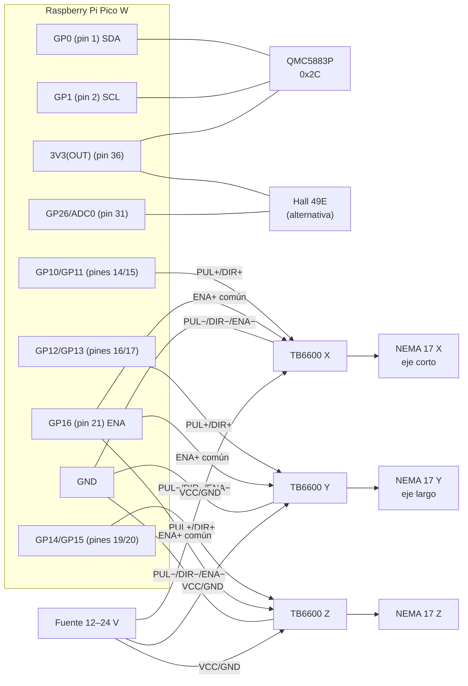

# 03 — Hardware

Este documento describe cada componente físico del SAVD (modelo exacto, función, alimentación y conexión), el cableado completo con los pines físicos y los GPIO de la Raspberry Pi Pico W, la mecánica de la mesa cartesiana (recorridos, posición de descanso, origen de la medición, ausencia de finales de carrera, orden de movimiento y compensación de holgura), el cálculo de la resolución y de la velocidad de posicionamiento, y la red que une a todos los equipos. Los valores proceden del código vigente (`firmware/config.py`) salvo que se indique otra fuente.

---

## 1. Componentes

| Componente | Modelo exacto | Función en el sistema | Alimentación | Conexión |
|---|---|---|---|---|
| Servidor | Raspberry Pi 5 con Raspberry Pi OS de 64 bits | Ejecuta Nginx, Node.js (backend) y MariaDB; sirve el dashboard | 5 V por USB-C (fuente oficial) | Wi-Fi o Ethernet a la misma red que la Pico y los usuarios |
| Microcontrolador | **Raspberry Pi Pico W** (RP2040 de doble núcleo Cortex-M0+, 264 kB de SRAM, 2 MB de flash, radio Infineon CYW43439 de 2,4 GHz) | Controla los motores, lee el sensor y se comunica con el servidor por Wi-Fi | 5 V por USB (computadora o cargador) o por VSYS | Wi-Fi 802.11n de 2,4 GHz |
| Magnetómetro triaxial | Módulo **QMC5883P** (QST), dirección I²C 0x2C | Sensor de prueba de tres ejes para validar el sistema | 3,3 V desde 3V3(OUT) de la Pico | I²C0: SDA en GP0, SCL en GP1, 100 kHz |
| Sensor Hall de un eje | **49E** (SS49E), lineal, analógico, encapsulado TO-92 | Sensor de prueba alternativo de un eje (Bz) | 3,3 V desde 3V3(OUT) | Salida a GP26/ADC0 |
| Drivers de motor | **TB6600** (tres unidades, una por eje) | Convierten los pulsos de paso y dirección en corriente para las bobinas del motor; entradas optoacopladas | 12–24 V de CC (admiten 9–42 V) | PUL, DIR y ENA desde la Pico; A+/A−/B+/B− al motor |
| Motores | **NEMA 17** bipolares de 200 pasos por vuelta (1,8° por paso), por ejemplo el 17HS4401 (1,5–1,7 A) | Mueven los tres ejes de la mesa | Desde su TB6600 | Dos bobinas, cuatro cables |
| Transmisión | **Husillos T8** (8 mm de diámetro, avance de 8 mm por vuelta en la versión de cuatro entradas) con tuerca | Convierten el giro del motor en desplazamiento lineal | — | Acoplados al eje del motor |
| Mesa | Mesa cartesiana XYZ | Lleva el sensor a cada punto de la malla | — | — |
| Fuente de potencia | Fuente de 12–24 V de CC, al menos 1,5 A por motor (por ejemplo, 24 V y 5 A para tres) | Alimenta los tres TB6600 | Red eléctrica | En estrella a cada driver |

### 1.1 Aclaración sobre el microcontrolador

El microcontrolador es la **Raspberry Pi Pico W**, basada en el RP2040. **No es la Raspberry Pi Pico 2 W** (basada en el RP2350), aunque algunos textos tempranos del proyecto y el nombre de un commit lo mencionen así. El firmware se escribe para MicroPython de la Pico W, versión 1.22 o posterior, porque necesita el acceso al controlador DMA (`rp2.DMA`).

### 1.2 Aclaración sobre el magnetómetro

El módulo se adquirió como «HMC5883L» y venía con una biblioteca de Arduino para ese chip, pero el circuito integrado es un **QMC5883P**: responde en la dirección I²C 0x2C, su registro de identificación (0x00) vale 0x80 y su mapa de registros es distinto del HMC5883L (0x1E) y del QMC5883L (0x0D). El documento 04 explica la diferencia y cómo se descubrió.

### 1.3 Sensores de prueba

El QMC5883P y el Hall 49E se usan como **sensores de prueba para validar el sistema completo**: posicionamiento, adquisición, transmisión, almacenamiento y visualización. El diseño del servidor permite sustituirlos, porque guarda las cuentas crudas y convierte con la configuración del sensor copiada en cada sesión.

---

## 2. Cableado

### 2.1 Tabla de pines de la Raspberry Pi Pico W

La serigrafía numera los pines físicos del 1 al 40 (el 1 arriba a la izquierda con el conector USB hacia arriba); el código usa los nombres GPxx.

| Señal | GPIO | Pin físico | Destino | Notas |
|---|---|---|---|---|
| SDA del QMC5883P | GP0 (I²C0) | 1 | SDA del módulo | 100 kHz; el módulo trae resistencias de *pull-up* |
| SCL del QMC5883P | GP1 (I²C0) | 2 | SCL del módulo | |
| Salida del Hall 49E | GP26 / ADC0 | 31 | Pata 3 (OUT) del 49E | Solo con el firmware del Hall |
| Alimentación de sensores | 3V3(OUT) | 36 | VCC del QMC5883P o pata 1 del 49E | **3,3 V, nunca 5 V** |
| Tierra analógica | AGND | 33 | Pata 2 (GND) del 49E | |
| Tierra | GND | 38 (y 3, 8, 13, 18, 23, 28) | GND del QMC5883P; PUL−, DIR− y ENA− de los TB6600 | |
| PUL+ del eje X | GP10 | 14 | TB6600 del eje X | Eje corto, 410 mm |
| DIR+ del eje X | GP11 | 15 | TB6600 del eje X | |
| PUL+ del eje Y | GP12 | 16 | TB6600 del eje Y | Eje largo, 562 mm |
| DIR+ del eje Y | GP13 | 17 | TB6600 del eje Y | |
| PUL+ del eje Z | GP14 | 19 | TB6600 del eje Z | 88 mm |
| DIR+ del eje Z | GP15 | 20 | TB6600 del eje Z | |
| ENA+ común | GP16 | 21 | ENA+ de los tres TB6600 | En 0 = drivers habilitados |
| Final de carrera X− | GP18 | 24 | Interruptor NC a GND | Previsto, **no instalado** |
| Final de carrera Y− | GP19 | 25 | Interruptor NC a GND | Previsto, **no instalado** |
| Final de carrera Z− | GP20 | 26 | Interruptor NC a GND | Previsto, **no instalado** |
| LED de estado | LED de la placa | — | — | Gobernado por el chip inalámbrico |

### 2.2 Conexión de los TB6600 (cátodo común)

Se usa el cableado de **cátodo común**: los bornes negativos de señal (PUL−, DIR− y ENA−) de los tres drivers van a una tierra de la Pico, y los positivos (PUL+, DIR+ y ENA+) a los GPIO. Un GPIO en alto (3,3 V) enciende el optoacoplador correspondiente. Con este cableado, **ENA+ en alto deshabilita** el driver; por eso el firmware lo mantiene en 0 mientras el programa corre, de modo que los motores sostienen su posición y nadie puede mover la mesa a mano (lo que haría perder la referencia).

- Las entradas del TB6600 están optoacopladas: la tierra de la Pico **no** se une a la tierra de la fuente de los motores.
- Los optoacopladores están pensados para 5 V; con 3,3 V funcionan si la corriente es suficiente, por lo que el firmware configura PUL y DIR con la máxima intensidad de salida del RP2040 (12 mA). Para el montaje definitivo se recomienda un búfer 74HCT245 alimentado a 5 V entre la Pico y los drivers, sobre todo para la línea ENA común, que con tres drivers en paralelo exigiría a un solo pin más corriente de la recomendable.
- Los pulsos son **simétricos y largos** (la mitad del periodo en alto y la otra mitad en bajo), porque con 3,3 V el optoacoplador no responde bien a pulsos cortos de unos 10 µs: el motor solo vibraba.
- Cada motor se conecta con sus dos bobinas a A+/A− y B+/B− (los pares se identifican con un multímetro: 1,5–3 Ω). Un eje que gira al revés se corrige en software (`"invertir"` en la configuración del eje), no recableando.
- Los interruptores DIP de corriente se ajustan a la corriente nominal del motor (1,5 A en el ejemplo del instructivo).

**Figura 3.1. Diagrama eléctrico simplificado.**

Orden de encendido recomendado: primero la Pico (USB) y luego la fuente de los motores; para apagar, al revés. Los cables se conectan siempre con todo apagado, y un motor nunca se desconecta de su driver con la fuente encendida.

---

## 3. Mecánica de la mesa

### 3.1 Sistema de coordenadas de máquina y recorridos

Las coordenadas de máquina están en milímetros y cada eje va de 0 a su límite. Los límites se midieron con el programa de calibración `prueba_calibracion.py`:

| Eje | Recorrido | GPIO (PUL/DIR) | Descripción |
|---|---|---|---|
| X | 0 a 410 mm | GP10 / GP11 | Eje corto |
| Y | 0 a 562 mm | GP12 / GP13 | Eje largo |
| Z | 0 a 88 mm | GP14 / GP15 | Altura del sensor |

Estos nombres coinciden en el firmware, en el programa de calibración y en el instructivo de conexiones desde el 14 de noviembre de 2026 (el 13 de noviembre se habían intercambiado X e Y en el firmware, y el cambio se deshizo al día siguiente; ver el documento 16).

Los **límites de software** impiden cualquier movimiento fuera de 0–límite: un destino fuera de rango se rechaza **antes de emitir un solo pulso** (`ErrorMovimiento`), y una sesión cuya zona no cabe en la mesa se rechaza entera antes de mover nada.

### 3.2 Posición de descanso y ausencia de finales de carrera

La mesa **no tiene finales de carrera instalados**. Sin interruptores, el firmware no puede saber dónde está la mesa al encender, así que **supone** que está en la **posición de descanso** configurada (`POSICION_ARRANQUE_*_MM`) y la usa como referencia para todo el resto de la sesión. Por eso:

- Antes de ejecutar el firmware, el operador debe dejar la mesa exactamente en la posición de descanso.
- Los drivers permanecen habilitados mientras el programa corre, para que los motores sostengan la posición.
- El firmware nunca se reinicia solo (sin `machine.reset()` ni watchdog), porque un reinicio tomaría como referencia la posición en que haya quedado la mesa.
- La mesa vuelve a la posición de descanso al completar una sesión, al detenerla desde el dashboard, ante un error, ante un 401 (token inválido) y al detener el programa con Ctrl+C.

**Valor vigente en el código:** la posición de descanso es **(0, 0, 0)**, es decir, el origen de la mesa. El comentario del archivo explica que la posición (0, 562, 88), que se había fijado el 14 de noviembre, «mandaba Y y Z contra su tope», y que se volvió a (0, 0, 0), como en el programa de calibración. Este último cambio no está registrado en git, y varios documentos del proyecto (e incluso el texto de ayuda de la página de configuración) todavía dicen (0, 562, 88); el documento 16 lo registra como contradicción. Las pruebas cortas en la mesa con el firmware `pico-tms-2.2` (sesiones 79 a 82) no permiten saber con cuál de los dos valores se hicieron.

El código de *homing* con finales de carrera (aproximación rápida, retroceso de 3 mm, aproximación lenta y separación de 1 mm) sigue en `motores.py` para cuando se instalen los interruptores; basta con indicar su GPIO en la configuración del eje.

### 3.3 Origen de la medición

Cada sesión tiene un **punto de inicio de la medición**: la posición, en coordenadas de máquina, donde queda el punto (0, 0, 0) de la zona de muestreo. Lo elige un administrador en la página (Configuración › General), se copia con cada sesión real y la Pico lo recibe en el latido. Por defecto es el origen (0, 0, 0). Desde ese punto la zona crece en el sentido positivo de los tres ejes (X+, Y+, Z+), con el plano $z = 0$ como el más bajo. La transformación se detalla en el documento 05.

### 3.4 Orden de movimiento de los ejes

La función `Mesa.mover_a` decide el orden de los ejes en cada desplazamiento:

- Si el destino tiene una Z **menor** que la actual, primero se mueven X e Y (a la vez) y después Z.
- Si el destino tiene una Z **mayor** o igual, primero se mueve Z y después X e Y.

La regla persigue que la mesa nunca cruce el área de trabajo con el sensor en su posición baja. El regreso a la posición de descanso (`Mesa.homing`) mueve primero Z hasta su coordenada de descanso y después X e Y a la vez. Esa regla se escribió suponiendo una posición de descanso con Z arriba (Z = 88). Con el descanso vigente en (0, 0, 0), el regreso lleva primero Z a 0 y luego desplaza X e Y; si $z = 0$ es también el punto físicamente más bajo del sensor, ese recorrido final se hace con el sensor abajo. Conviene confirmarlo en la mesa (documento 17).

### 3.5 Compensación de la holgura del husillo

Los husillos con tuerca tienen juego (holgura) al cambiar de sentido. El firmware aplica una **aproximación unidireccional**: si un eje debe moverse en sentido negativo, primero se pasa del destino $h = 0{,}5$ mm y luego regresa en sentido positivo. Así cada punto se alcanza siempre desde el mismo lado. En la serpentina, la mitad de las filas van en sentido X−, de modo que cada punto de esas filas hace ese vaivén; con los parámetros por defecto añade entre 0,06 s y 0,07 s por punto, alrededor del 5 % de un barrido de 845 puntos. En Y ocurre una vez por fila en los planos impares, y en Z nunca. Se desactiva por eje con una holgura de 0.

---

## 4. Resolución y velocidad de posicionamiento

### 4.1 Resolución teórica

Sea $L$ el avance del husillo por vuelta, $N_p$ el número de pasos completos por vuelta del motor y $\mu$ el factor de micropasos del driver. El desplazamiento por pulso es:

$$\delta = \frac{L}{N_p\,\mu}$$

donde $\delta$ está en mm por pulso, $L$ en mm por vuelta, $N_p = 200$ pasos por vuelta y $\mu$ es adimensional (1, 2, 4, 8, 16 o 32). El factor de conversión que usa el firmware es su inverso, $k = 1/\delta$, en pulsos por milímetro.

Con el husillo T8 de $L = 8$ mm:

| Configuración | Pulsos por vuelta ($N_p\,\mu$) | $\delta$ (mm/pulso) | $k$ (pulsos/mm) |
|---|---|---|---|
| Paso completo ($\mu = 1$) | 200 | 0,04 | 25 |
| **Medio paso ($\mu = 2$), la configurada** | **400** | **0,02** | **50** |
| 1/8 de paso ($\mu = 8$), la que recomienda el instructivo | 1 600 | 0,005 | 200 |

El firmware y el programa de calibración usan **$k = 50$ pulsos/mm** en los tres ejes, sin inversiones. Según el comentario del programa de calibración, ese valor corresponde a 400 pulsos por vuelta en el TB6600. El paso completo del sistema motor-husillo es de 0,04 mm, y la resolución de mando con la configuración vigente es de 0,02 mm por pulso.

**Verificación:** el tesista confirmó que, con 50 pulsos/mm, cada eje **avanza la distancia pedida** (calibración cualitativa con el programa de calibración y uso real en la mesa). No hay registro numérico del error medido.

### 4.2 Error de cuantización y requisito de ±1 mm

Cada destino en milímetros se convierte en un número entero de pulsos:

$$n = \operatorname{redondeo}(x \cdot k)$$

por lo que el error de cuantización máximo es $\delta/2 = 0{,}01$ mm, dos órdenes de magnitud por debajo del requisito de error posicional de **±1 mm**. Las demás fuentes de error son la holgura del husillo (compensada con la aproximación unidireccional), los pasos perdidos (el principal riesgo, porque sin finales de carrera un paso perdido desplaza la referencia de forma permanente) y la exactitud del valor de $k$. El servidor usa la misma tolerancia de 1 mm para decidir si una lectura cubre un punto de la malla (documento 07).

### 4.3 Velocidad, rampas y frecuencia de pulsos

| Parámetro | Valor | Equivalente con $k = 50$ |
|---|---|---|
| Velocidad de crucero `VEL_MAX_MM_S` | 60 mm/s | 3 000 pulsos/s; 7,5 vueltas/s (450 rpm) |
| Velocidad de arranque y final `VEL_INICIO_MM_S` | 6 mm/s | 300 pulsos/s |
| Aceleración `ACEL_MM_S2` | 300 mm/s² | 15 000 pulsos/s² |
| Frecuencia máxima `FRECUENCIA_MAX_HZ` | 15 000 Hz | Tope de seguridad (el TB6600 admite unos 20 kHz) |

Cada movimiento sigue una **rampa trapezoidal**: acelera de $v_0$ a $v_{max}$ con aceleración $a$, mantiene la velocidad de crucero y frena con la misma rampa. La distancia de aceleración es:

$$d_a = \frac{v_{max}^2 - v_0^2}{2a} = \frac{60^2 - 6^2}{2 \cdot 300} = 5{,}94\ \text{mm}$$

y su duración, $t_a = (v_{max} - v_0)/a = 0{,}18$ s. Si el desplazamiento $d$ es menor que $2d_a$, la rampa es triangular y la velocidad máxima alcanzada es:

$$v_p = \sqrt{v_0^2 + a\,d}$$

con una duración total de $t = 2(v_p - v_0)/a$. Para un paso de malla de 10 mm resulta $v_p = 55{,}1$ mm/s y $t = 0{,}33$ s; para 5 mm, $v_p = 39{,}2$ mm/s y $t = 0{,}22$ s. Sumando la espera de asentamiento de 300 ms y las diez lecturas del sensor a 200 Hz (unos 50 ms), se estiman unos 0,68 s por punto con un paso de 10 mm. Las sesiones reales completas con ese paso midieron entre 0,74 s y 0,78 s por punto, lo que concuerda con el cálculo si se suma el tiempo de comunicación y el de la holgura.

La rampa se discretiza en 24 tramos de velocidad. Cada tramo se convierte en un periodo de pulso que genera el bloque PIO del RP2040 con una resolución de 1 µs:

$$T = 2Y + 7\ \ \mu\text{s}$$

donde $Y$ es un entero de 16 bits que fija la mitad del periodo (pulso simétrico) y 7 µs son los ciclos fijos de las instrucciones del programa PIO. A 3 000 pulsos/s, $T \approx 333$ µs y $Y = 163$. El documento 05 explica cómo se codifican los tramos y cómo los transfiere el DMA.

El programa de calibración usa su propia generación de pulsos por software: un semiperiodo de 100 µs (5 000 pulsos/s, es decir, 100 mm/s), con una rampa que arranca en un semiperiodo de 1 500 µs y acelera durante 300 pulsos.

### 4.4 Tiempo de un barrido real

Con el ritmo medido en las sesiones reales del QMC5883P con paso de 10 mm (0,74–0,78 s por punto), un barrido de 845 puntos (60 × 60 × 20 mm con paso de 5 mm) duraría unos 10 a 11 minutos. Es una estimación: no hay ningún barrido real de 845 puntos guardado.

---

## 5. Red

### 5.1 Topología prevista

El servidor, la Pico W y los equipos de los usuarios se conectan a la misma red Wi-Fi: el **hotspot de un iPhone** con salida a internet. Varias personas (el director de tesis, un ingeniero, el tesista y un compañero) miran el dashboard al mismo tiempo desde laptops y teléfonos.

- La Pico W solo usa la banda de **2,4 GHz**; en el iPhone hay que activar la opción «Maximizar compatibilidad».
- El hotspot del iPhone asigna direcciones 172.20.10.x y puede cambiar la IP de la Raspberry Pi 5 de una sesión a otra.
- La salida a internet permite que la Pico sincronice su reloj por NTP (`pool.ntp.org`). Sin internet, la Pico sigue funcionando y el servidor usa su propia hora de recepción.

### 5.2 Cómo encuentra la Pico al servidor

La dirección del servidor se escribe en el archivo de secretos de la Pico (`secretos.py`, excluido de git), junto con las credenciales del Wi-Fi y el token del dispositivo. Hay tres opciones documentadas:

1. **IP fija** del servidor, revisada antes de cada sesión (la más simple y la que se ha usado).
2. **Nombre mDNS** (`tms.local`), que anuncia Avahi en la Raspberry Pi 5 y sigue funcionando aunque cambie la IP; MicroPython no resuelve nombres `.local` en todas sus versiones.
3. Una lista de direcciones que el firmware prueba en orden.

En producción, la Pico llama a `https://<servidor>/api/...` a través de Nginx (el cliente HTTP de MicroPython no valida el certificado autofirmado; la autenticación la da el token). En desarrollo, llama directamente a `http://<IP de la laptop>:4000/api/...`, con el backend arrancado para escuchar en todas las interfaces.

### 5.3 Red usada en las pruebas reales

Las pruebas con la mesa de noviembre de 2026 se hicieron con el backend en la laptop de desarrollo y con la red Wi-Fi de un enrutador del laboratorio, no con el hotspot ni con la Raspberry Pi 5. El acceso simultáneo de varios dispositivos a través del hotspot está documentado, pero sigue pendiente de comprobar con el hardware (documento 14).

---

## Fuentes en el proyecto

- `firmware/config.py`, `firmware/motores.py`, `firmware/main.py`, `firmware/banco.py`, `firmware/prueba_calibracion.py`
- `firmware/README.md` (secciones 2, 3, 6 y 8)
- `docs/instructivo-calibracion-y-conexiones.md`
- `docs/sensor-qmc5883p.md` (sección 1), `docs/firmware-pico-w.md` (secciones 5 y 6)
- `firmware_hall_1d/README.md`, `firmware_hall_1d/config.py`
- `COMANDOS.md` (secciones 10 y 11)
- Bitácora de desarrollo del proyecto (tabla de hardware)
- Base de datos local `tms_db`: ritmo por punto de las sesiones reales
