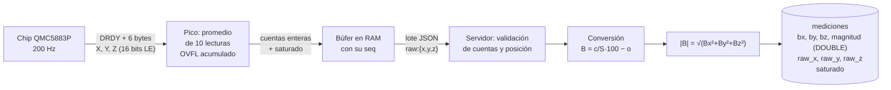

# 04 — Sensores y medición

Este documento describe los dos sensores de prueba del SAVD: el magnetómetro triaxial digital QMC5883P y el sensor Hall lineal analógico 49E. Cubre los registros, la inicialización y la lectura del QMC5883P, sus rangos y la detección de saturación, el promediado y la resta del campo de fondo, las ecuaciones de conversión de cuentas a unidades físicas, el funcionamiento y la calibración del Hall 49E, y la historia de cómo el sensor esperado (HMC5883L) resultó ser otro y cómo se adaptó el servidor para admitir los dos formatos. Ambos sensores son de prueba: sirven para validar el funcionamiento completo del sistema.

---

## 1. Magnetómetro QMC5883P

### 1.1 Características

| Característica | Valor |
|---|---|
| Tipo | Magnetómetro triaxial digital |
| Interfaz | I²C, dirección 0x2C |
| Identificación | Registro 0x00 = 0x80 |
| Resolución del convertidor | 16 bits con signo por eje (−32 768 a 32 767) |
| Rangos | ±2, ±8, ±12 y ±30 G |
| Frecuencia de salida usada | 200 Hz (modo continuo) |
| Alimentación | 3,3 V |
| Conexión | SDA → GP0 (pin 1), SCL → GP1 (pin 2), VCC → 3V3(OUT) (pin 36), GND → pin 38; I²C0 a 100 kHz |

### 1.2 Registros

| Registro | Nombre | Uso |
|---|---|---|
| 0x00 | Chip ID | Siempre 0x80; confirma que el chip es el correcto |
| 0x01–0x06 | Datos X, Y, Z | Tres enteros de 16 bits con signo, **byte bajo primero**, en el orden **X, Y, Z** |
| 0x09 | Estado | Bit 0 `DRDY`: hay un dato nuevo. Bit 1 `OVFL`: saturación |
| 0x0A | Control 1 | 0xCD: modo normal, 200 Hz, filtro máximo |
| 0x0B | Control 2 | *Set/Reset* y rango (bits 3–2) |
| 0x29 | Signo de los ejes | 0x06, según la hoja de datos |

### 1.3 Secuencia de inicialización

Al encenderse, el chip está en reposo y todas sus lecturas valen 0. La inicialización, en este orden, es:

1. Leer el registro 0x00 y comprobar que vale 0x80.
2. Escribir 0x06 en 0x29 (signo de los ejes).
3. Escribir los bits del rango desplazados dos posiciones a la izquierda en 0x0B.
4. Escribir 0xCD en 0x0A (modo normal a 200 Hz). **Sin este paso, todas las lecturas valen 0.**
5. Esperar 20 ms.

Antes de inicializar, el firmware escanea el bus. Si no encuentra la dirección 0x2C, distingue los casos frecuentes: un HMC5883L en 0x1E, un QMC5883L en 0x0D o el bus vacío (cableado), y emite un mensaje claro para cada uno.

### 1.4 Lectura

1. Esperar a que el bit `DRDY` (registro 0x09, bit 0) valga 1, con un límite de 100 ms. Mientras espera, el firmware **cede el control** al bucle principal (es un generador), de modo que la comunicación con el servidor no se detiene.
2. Leer 6 bytes desde 0x01 e interpretarlos como tres enteros de 16 bits con signo, byte bajo primero, en el orden X, Y, Z.
3. La lectura está **saturada** si el bit `OVFL` (0x09, bit 1) vale 1. A diferencia del HMC5883L, el QMC5883P no indica la saturación con un valor especial: −4096 es una cuenta válida.

### 1.5 Rangos

El rango se elige con los bits 3–2 del registro 0x0B:

| Rango | Bits | Cuentas por gauss ($S$) | Resolución (1 cuenta) | Fondo de escala nominal | Fondo de escala del convertidor ($32\,767/S \cdot 100$) |
|---|---|---|---|---|---|
| ±30 G | 0 | 1 000 | 0,1 µT | ±3 000 µT | ±3 276,7 µT |
| ±12 G | 1 | 2 500 | 0,04 µT | ±1 200 µT | ±1 310,7 µT |
| ±8 G | 2 | 3 750 | 0,027 µT | ±800 µT | ±873,8 µT |
| ±2 G | 3 | 15 000 | 0,0067 µT | ±200 µT | ±218,4 µT |

Conviene usar el rango más pequeño que no sature. El fondo se mide siempre en 30 G, el único que nunca satura dentro de lo previsto; durante una sesión se usa el rango que indica la configuración del sensor copiada en esa sesión (30 G por defecto).

### 1.6 Promediado

Cada medición promedia $N = 10$ lecturas consecutivas (`PROMEDIO_QMC`), unos 50 ms a 200 Hz. Si el ruido de cada lectura es independiente con desviación típica $\sigma$, la desviación del promedio es:

$$\sigma_{\bar{B}} = \frac{\sigma}{\sqrt{N}}$$

de modo que promediar diez lecturas reduce el ruido unas $\sqrt{10} \approx 3{,}2$ veces (la documentación del sensor estima un ruido de unos ±0,3 µT por lectura en el rango de 30 G). El promedio de cuentas se redondea a un entero antes de enviarse. **Si cualquiera de las diez lecturas trae `OVFL`, la medición completa se marca como saturada.**

### 1.7 Campo de fondo

El campo que mide el sensor con la bobina apagada (el campo terrestre, de unos 25 a 65 µT, más el del entorno: hierro de la mesa, cables y la propia electrónica) se denomina **fondo**. El firmware lo mide al arrancar, con la mesa en la posición de descanso y la bobina apagada, promediando 100 lecturas en 30 G, y lo imprime por eje en la consola. En espera (sin sesión), el botón BOOTSEL de la Pico lo vuelve a medir.

Por defecto (`RESTAR_FONDO_EN_PICO = False`), la Pico **no** resta el fondo: envía las cuentas crudas tal como las midió el chip, para no perder trazabilidad. El operador copia el fondo impreso en Configuración › Sensor › *offset* ($o_x$, $o_y$, $o_z$, en µT), y el servidor lo resta al convertir. Si se activa la resta en la Pico, el *offset* del servidor debe quedar en 0. El fondo debe volver a medirse si cambia la orientación del sensor.

### 1.8 Recuperación ante errores del bus

Ante un error del bus I²C (`OSError`, por ejemplo `EIO`), el firmware espera 100 ms y vuelve a inicializar el chip una vez. Si vuelve a fallar, lanza un `ErrorSensor`: la sesión se da por fallida, se envían las lecturas ya tomadas y la mesa vuelve a la posición de descanso. La siguiente sesión vuelve a verificar el sensor.

---

## 2. Conversión de cuentas a unidades físicas

### 2.1 QMC5883P

Para cada eje $i \in \{x, y, z\}$, el servidor convierte las cuentas crudas $c_i$ a microtesla con la configuración del sensor copiada en la sesión:

$$B_i = \frac{c_i}{S} \cdot 100 - o_i$$

| Símbolo | Significado | Unidades |
|---|---|---|
| $B_i$ | Componente del campo en el eje $i$ | µT |
| $c_i$ | Cuentas crudas del eje $i$ (−32 768 a 32 767) | cuentas |
| $S$ | Cuentas por gauss del rango (`cuentas_por_g`: 1 000, 2 500, 3 750 o 15 000) | cuentas/G |
| 100 | Factor de conversión de gauss a microtesla | µT/G |
| $o_i$ | *Offset* (fondo) configurado para el eje $i$ | µT |

Las equivalencias en otras unidades son $B_i[\text{mT}] = B_i[\mu\text{T}]/1000$ y $B_i[\text{G}] = B_i[\mu\text{T}]/100$.

### 2.2 HMC5883L (formato que usa el firmware del Hall)

Con el modelo HMC5883L, las cuentas van de −4096 a 2047 y la conversión es análoga, con la ganancia $G$ en LSB por gauss (`lsb_por_ga`):

$$B_i = \frac{c_i}{G} \cdot 100 - o_i$$

Una cuenta igual a −4096 en un eje significa **desbordamiento**: ese eje se guarda como nulo y la lectura se marca como saturada. El fondo de escala por eje es:

$$B_{fs} = \frac{2047}{G} \cdot 100$$

| Rango (Ga) | $G$ (LSB/Ga) | $B_{fs}$ (µT) |
|---|---|---|
| 0,88 | 1 370 | 149,4 |
| 1,3 | 1 090 | 187,8 |
| **1,9 (por defecto para este modelo)** | **820** | **249,6** |
| 2,5 | 660 | 310,2 |
| 4,0 | 440 | 465,2 |
| 4,7 | 390 | 524,9 |
| 5,6 | 330 | 620,3 |
| 8,1 | 230 | 890,0 |

### 2.3 Módulo del campo

$$|B| = \sqrt{B_x^2 + B_y^2 + B_z^2}$$

en µT. El módulo no depende de la orientación del sensor, por lo que es el valor más cómodo para comparar mediciones. Si la lectura está saturada, $|B|$ se guarda como nulo.

### 2.4 Tratamiento de la saturación en el servidor

| Caso | Qué se guarda |
|---|---|
| La lectura trae `saturado: true` (bit `OVFL` del QMC5883P; válido con los dos modelos) | $B_x$, $B_y$, $B_z$ y $\|B\|$ nulos; se conservan las cuentas crudas; `saturado = 1` |
| Modelo HMC5883L y un eje vale −4096 | Ese eje nulo, $\|B\|$ nulo, `saturado = 1`; los demás ejes se convierten |
| Modelo QMC5883P y un eje vale −4096 | Cuenta válida: se convierte normalmente |

Las lecturas saturadas **no cuentan** para el máximo ni el mínimo que muestra el historial, y no cubren su punto de la malla (dejan un «hueco»). El historial informa cuántas hay en cada sesión.

### 2.5 Dónde se hace cada operación

**Figura 4.1. Flujo de una lectura del QMC5883P desde el chip hasta la base de datos.**

Guardar las cuentas crudas permite recalcular los µT si después cambia la calibración (el *offset*) sin repetir la medición.

---

## 3. Sensor Hall 49E

### 3.1 Principio de funcionamiento

El 49E (SS49E) es un sensor de efecto Hall **lineal de un eje**: su salida es una tensión proporcional a la componente del campo perpendicular a su cara rotulada. Sin campo, la salida queda a la mitad de la alimentación (unos 1,65 V con 3,3 V); un polo magnético la sube y el otro la baja. Su respuesta es raciométrica: la sensibilidad escala con la tensión de alimentación.

$$V_{out} = V_0 + s \cdot B$$

| Símbolo | Significado | Valor o unidades |
|---|---|---|
| $V_{out}$ | Tensión de salida | V |
| $V_0$ | Tensión sin campo (cero), calibrada al arrancar | ≈ 1,65 V |
| $s$ | Sensibilidad | 14 mV/mT con 5 V; $14 \cdot 3{,}3/5 = 9{,}24$ mV/mT con 3,3 V |
| $B$ | Campo perpendicular a la cara rotulada | mT |

### 3.2 Lectura con el ADC de la Pico

El sensor se conecta a GP26/ADC0. El firmware promedia 256 lecturas del ADC en cada medición y las convierte a voltios con la referencia de 3,3 V. El convertidor del RP2040 es de 12 bits, de modo que su resolución es:

$$\Delta V = \frac{3{,}3\ \text{V}}{4096} \approx 0{,}81\ \text{mV} \quad\Rightarrow\quad \Delta B = \frac{\Delta V}{s} \approx \frac{0{,}81}{9{,}24} \approx 0{,}09\ \text{mT}$$

Es decir, el paso mínimo es de unos 90 µT: el Hall no ve el campo terrestre, pero sí un imán o una bobina intensa (decenas de mT a pocos centímetros). Se considera saturado cuando la salida queda a menos de 0,2 V de 0 V o de la alimentación (más de unos ±150 mT).

El campo se obtiene como:

$$B_z = \frac{(V - V_0) \cdot 1000}{s}\quad[\text{mT}]$$

con $V$ y $V_0$ en voltios y $s$ en mV/mT.

### 3.3 Calibración del cero

Al arrancar, el firmware promedia la salida durante 2 s sin imanes cerca ni bobina encendida y toma ese valor como $V_0$. Si el cero queda pegado a 0 V o a 3,3 V, informa un error de cableado; si se aleja más de 0,35 V de la mitad de la alimentación, avisa de que puede haber un imán cerca. En espera, el botón BOOTSEL repite la calibración.

### 3.4 Envío al servidor en formato HMC5883L y advertencia de unidades

El firmware del Hall (`firmware_hall_1d/`) es anterior a la adaptación del servidor al QMC5883P y envía las lecturas en el formato de cuentas del HMC5883L. Hace la conversión inversa con la ganancia de la sesión:

$$c_z = \operatorname{redondeo}\!\left(\frac{(B_z + o_z) \cdot G}{100}\right)$$

y manda −4096 si el resultado no cabe en −2048..2047 o si el sensor está en el riel. $B_x$ y $B_y$ se envían como 0.

Como el Hall mide decenas de militesla, en microtesla reales todo saturaría (el fondo de escala con 1,9 Ga es de 249,6 µT). Por eso, con la opción por defecto `UNIDAD_ENVIO = "mT"`, el firmware envía el valor **en militesla** donde el servidor espera microtesla: **el número que muestra el dashboard rotulado como µT corresponde en realidad a mT** en las sesiones del Hall, con un rango de ±249,6 mT y un paso de $100/820 \approx 0{,}12$ mT, parecido a la resolución del ADC. La documentación recomienda anotarlo en las notas de cada sesión del Hall.

**Requisito de configuración:** antes de usar el firmware del Hall hay que poner el modelo **HMC5883L** en Configuración › Sensor. Con el modelo QMC5883P, el servidor dividiría esas cuentas entre `cuentas_por_g` y las guardaría mal escaladas, sin ningún error. Como protección, si con el modelo QMC5883P llega un lote cuyas cuentas caben todas en −4096..2047 y alguna vale exactamente −4096, el servidor escribe un aviso en su registro. Solo avisa: no rechaza nada y no detecta el caso si el Hall nunca satura.

---

## 4. Historia del sensor

| Fecha | Hecho |
|---|---|
| Junio de 2026 | La primera versión del sistema hablaba de un «sensor Hall» de tres ejes con acondicionamiento analógico (un filtro activo MFB de Bessel) y simulaba los datos en el navegador. |
| 10 de noviembre de 2026 | El firmware de la Pico se escribe para un magnetómetro **HMC5883L** (dirección 0x1E, cuentas de −2048 a 2047, desbordamiento en −4096, orden de registros X, Z, Y con byte alto primero), que es como se vendía el módulo. |
| 11 de noviembre de 2026 | El módulo no responde como HMC5883L. Mientras tanto se construye un firmware completo con un sensor **Hall 49E** de un eje en el ADC (`firmware_hall_1d/`), que envía en formato HMC5883L. Por la tarde se hacen las primeras sesiones reales en la mesa con el Hall (59 a 65). |
| 12 de noviembre de 2026 | Se descubre que el módulo es un **QMC5883P** (0x2C, Chip ID 0x80). Se escriben y prueban los programas independientes del QMC5883P, se borran las pruebas del HMC5883L y la biblioteca de Arduino del HMC5883 (recuperables desde git), se adapta el firmware cliente (clase `QMC5883P`) y se adapta el servidor para admitir los dos modelos (migración 008: el modelo por defecto pasa a QMC5883P en 30 G). Primeras sesiones reales con el firmware principal y el QMC5883P (66 y 67). |
| 13 de noviembre de 2026 | Barridos completos con el QMC5883P en la mesa (sesiones 69, 72, 73 y 74). |

### 4.1 Diferencias entre el HMC5883L esperado y el QMC5883P real

| Aspecto | HMC5883L (lo que suponía el firmware inicial) | QMC5883P (el módulo real) |
|---|---|---|
| Dirección I²C | 0x1E | **0x2C** |
| Identificación | Registros 0x0A–0x0C = «H43» | **0x00 = 0x80** |
| Orden y formato de los datos | X, Z, Y; byte alto primero | **X, Y, Z; byte bajo primero** |
| Saturación | El eje vale −4096 | **Bit OVFL** (0x09, bit 1) |
| Cuentas | −2048 a 2047 | −32 768 a 32 767 |
| Rangos | 0,88 a 8,1 Ga | **2, 8, 12 y 30 G** |
| Modo de medición | Medición única a pedido | Continua a 200 Hz; se espera DRDY |

### 4.2 Cómo admite el servidor los dos modelos

La clave de configuración `sensor` lleva un campo `modelo`:

- **`QMC5883P`** (por defecto): `rango_g` ∈ {2, 8, 12, 30} y `cuentas_por_g` derivado del rango; cuentas de 16 bits; saturación por el campo `saturado` de cada lectura.
- **`HMC5883L`**: `rango_ga` (una de las ocho ganancias) y `lsb_por_ga` derivado; cuentas de −4096 a 2047; −4096 = desbordamiento.

Cambiar de modelo (con el selector de Configuración › Sensor) carga los valores por defecto de ese modelo (QMC5883P en 30 G o HMC5883L en 1,9 Ga) y conserva las lecturas por punto y el *offset*. No se puede cambiar con una sesión abierta (409). Cada sesión guarda su copia del sensor, de modo que las sesiones antiguas del HMC5883L se siguen interpretando con su propia configuración.

El firmware principal también funciona con los dos formatos: si el latido indica `modelo = "QMC5883P"`, programa el rango de la sesión y envía cuentas crudas del QMC con el indicador `saturado`; con cualquier otro modelo, mide en 30 G y envía «cuentas HMC» (calculadas con la ganancia de la sesión, con −4096 en los tres ejes si hubo OVFL o si no cabe), limitadas a ±249,6 µT con 1,9 Ga. La sesión real 66 (firmware principal en modo HMC con el QMC5883P) guardó 85 de sus 108 lecturas como saturadas por ese límite, mientras que la sesión 67, con el mismo montaje en modo QMC5883P, midió hasta 2 876,6 µT con solo 5 saturadas cerca del fondo de escala de 30 G.

---

## Fuentes en el proyecto

- `docs/sensor-qmc5883p.md` (secciones 1 a 7)
- `docs/firmware-pico-w.md` (sección 4)
- `firmware/sensor.py`, `firmware/config.py`, `firmware/prueba_qmc5883p.py`, `firmware/medicion_campo_qmc5883p.py`, `firmware/prueba_hall_49e.py`
- `firmware_hall_1d/sensor_hall.py`, `firmware_hall_1d/config.py`, `firmware_hall_1d/README.md`
- `server/services/conversionSensor.js`, `server/services/validacionConfiguracion.js`, `server/services/configuracion.js`, `server/services/ingesta.js`
- `server/migrations/008_sensor_qmc5883p.sql`
- Historial de git (commits `22d3e7f`, `4d6658a`, `f1e1d76`, `27530e3`, `bd5af92`) y versión original de `README.md`
- Base de datos local `tms_db`: sesiones reales 59 a 82
