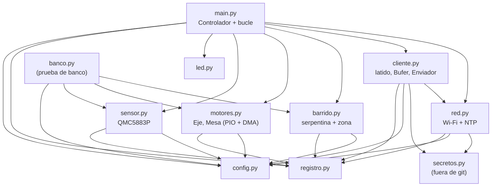
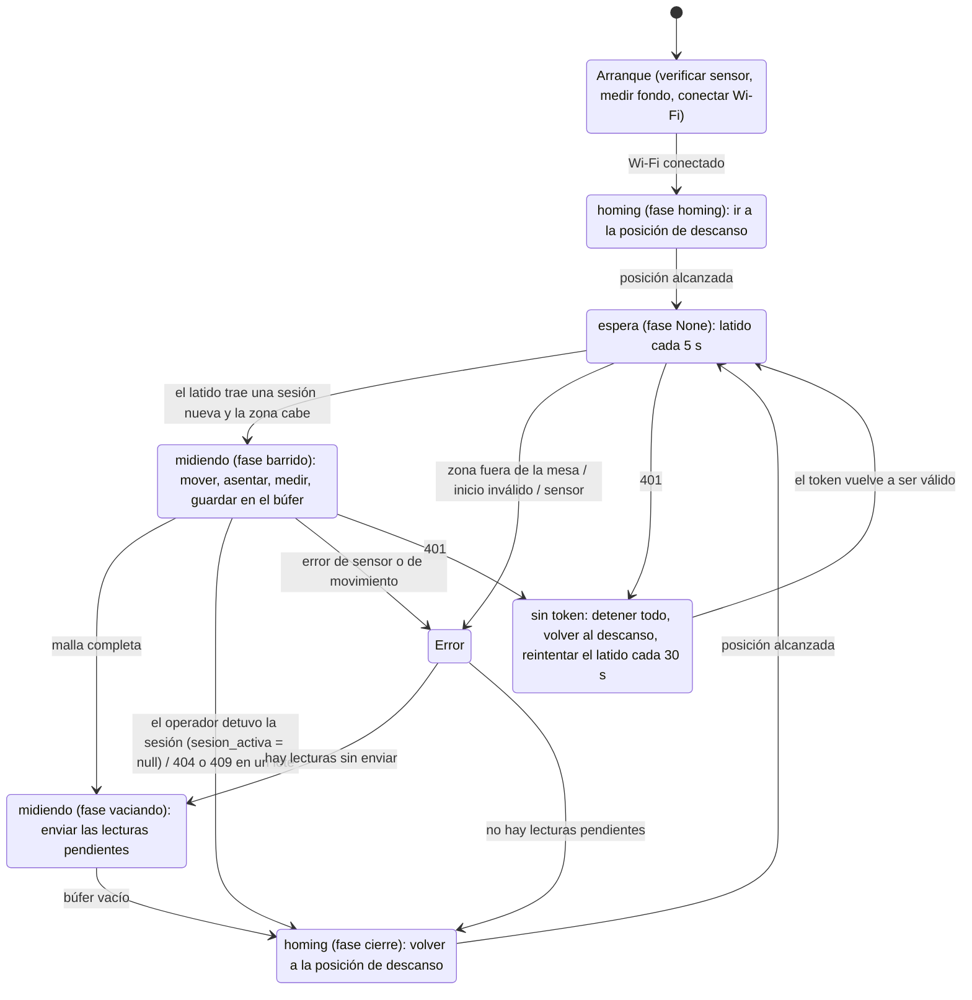

# 05 — Firmware de la Raspberry Pi Pico W

Este documento describe el firmware que corre en la Raspberry Pi Pico W, escrito en MicroPython: sus módulos y la responsabilidad de cada uno, la arquitectura de bucle cooperativo con generadores, la generación de pulsos de paso con el bloque PIO y el controlador DMA del RP2040, la máquina de estados del dispositivo y las señales del LED, el recorrido en serpentina y la conversión de coordenadas de la zona a coordenadas de la mesa, la numeración de las lecturas, el búfer y el envío por lotes, la reanudación tras un reinicio o una caída de la red, los programas independientes de prueba y calibración, la variante para el sensor Hall y las pruebas que se hacen en una computadora. La versión descrita es `pico-tms-2.2`.

---

## 1. Plataforma

- **Lenguaje:** MicroPython para la Raspberry Pi Pico W (no la Pico 2 W), **versión 1.22 o posterior**. Esa versión es necesaria porque el firmware usa `rp2.DMA` para alimentar al PIO; con una versión anterior, los movimientos bloquean el programa y el firmware lo avisa en la consola.
- **Arranque:** `main.py` se ejecuta solo al encender la Pico. Si se mantiene pulsado el botón BOOTSEL durante los tres primeros segundos, el firmware no arranca (modo de edición).
- **Carga:** con Thonny o con `mpremote`, se copian a la raíz de la Pico `config.py`, `secretos.py`, `registro.py`, `red.py`, `cliente.py`, `sensor.py`, `motores.py`, `barrido.py`, `led.py`, `banco.py` y `main.py`.
- **Secretos:** el nombre y la contraseña de la red Wi-Fi, la dirección del servidor y el token del dispositivo van en `secretos.py`, que está excluido de git; el repositorio solo incluye la plantilla `secretos_ejemplo.py`.
- **Versión que se informa al servidor:** `FIRMWARE = "pico-tms-2.2"` en `config.py`; se envía en cada latido y se guarda con cada sesión real.

---

## 2. Módulos

| Módulo | Responsabilidad |
|---|---|
| `main.py` | Bucle principal y clase `Controlador`: mantiene el Wi-Fi, envía el latido, reacciona a la sesión activa, avanza la tarea en curso (barrido o regreso al descanso), envía los lotes, actualiza el LED y atiende BOOTSEL. Contiene el apagado ordenado ante Ctrl+C o un fallo inesperado. |
| `config.py` | Todo lo que se ajusta: límites de la mesa, posición de descanso, punto de inicio por defecto y sentidos de los ejes, pines, factores de los motores, holgura, parámetros del sensor, velocidades y aceleración, tamaño de lote, búfer, tiempos de reintento, NTP y opciones del sistema. |
| `red.py` | Conexión Wi-Fi (bloqueante al inicio y no bloqueante después, con reintento cada 10 s), ahorro de energía desactivado para reducir la latencia, sincronización del reloj por NTP (cada hora, o cada minuto si falló) y hora UTC en milisegundos. |
| `cliente.py` | Peticiones HTTP con el token: latido y envío de lotes. Contiene el búfer circular de lecturas y la lógica de reintento con espera creciente. |
| `sensor.py` | Clase `QMC5883P`: escaneo del bus, identificación, inicialización por rango, lectura con DRDY y OVFL, promedio, fondo y los dos formatos de envío (QMC crudo o «cuentas HMC»). |
| `motores.py` | Clases `Eje` y `Mesa`: programa PIO de pasos, perfil trapezoidal, codificación de segmentos, transferencia por DMA, parada brusca con estimación de los pasos dados, orden de los ejes, holgura y *homing* (con o sin finales de carrera). |
| `barrido.py` | Malla de la sesión en serpentina, conversión de coordenadas de la zona a coordenadas de máquina, validación de que la zona cabe en la mesa, reanudación por `seq` y el generador que ejecuta el barrido. |
| `led.py` | Patrones del LED de la placa, movidos por un temporizador de 100 ms (siguen parpadeando aunque el programa espere una respuesta HTTP). |
| `registro.py` | Registro por la consola USB con la hora UTC (o el tiempo desde el arranque si no hay NTP). |
| `banco.py` | Prueba de banco y calibración sin servidor ni Wi-Fi, desde la consola de Thonny. |

**Figura 5.1. Dependencias entre los módulos del firmware.**

---

## 3. Arquitectura: bucle cooperativo con generadores

El firmware no usa hilos. El `Controlador` ejecuta un bucle en el que cada vuelta hace, en orden:

1. Mantener el Wi-Fi (`red.mantener()`); si la red acaba de volver, reinicia la espera de reintento y adelanta el latido.
2. Enviar el latido si ya toca (cada `intervalo_latido_s`, 5 s por defecto, o cada 30 s después de un 401) y reaccionar a la `sesion_activa` de la respuesta.
3. **Avanzar un paso de la tarea en curso**. La tarea es un **generador** de Python (el barrido, el regreso al descanso o el *homing*) que cede el control con `yield` cada vez que tiene que esperar: mientras un eje se mueve, durante el asentamiento de 300 ms o mientras el sensor no tiene un dato nuevo.
4. Enviar un lote si hay suficientes lecturas o si la más antigua lleva demasiado tiempo esperando.
5. Revisar BOOTSEL (en espera, vuelve a verificar el sensor y a medir el fondo), actualizar el LED y, si no hay tarea, dormir 20 ms.

Gracias a que el movimiento lo ejecuta el hardware (PIO + DMA) y a que las esperas ceden el control, **un lote puede enviarse por Wi-Fi mientras la mesa va al siguiente punto**, y el latido no se interrumpe durante el barrido.

### 3.1 Generación de pulsos con PIO y DMA

Cada eje tiene una **máquina de estados del PIO** del RP2040 a 1 MHz (un ciclo por microsegundo) que ejecuta un programa de diez instrucciones. El programa toma palabras de 32 bits de su cola de entrada; cada palabra describe un **segmento** del movimiento:

| Bits | Contenido |
|---|---|
| 0–14 | Número de pasos del segmento menos uno (hasta 32 768 pasos) |
| 15 | Sentido (DIR) |
| 16–31 | Espera $Y$; el periodo de cada paso es $T = 2Y + 7$ µs, con el pulso simétrico |

Para cada segmento, el programa fija DIR, espera 16 µs de preparación (el TB6600 pide al menos 5 µs), y emite $n$ pulsos con la mitad del periodo en alto y la otra mitad en bajo. Un canal **DMA** copia las palabras del movimiento completo desde la memoria a la cola del PIO, sincronizado con la señal de petición del PIO; una vez lanzado, el movimiento ocurre íntegramente en hardware.

El fin del movimiento se detecta por tiempo (la duración total de los segmentos se calcula al codificarlos) y por el estado del DMA. La **parada brusca** (al detener una sesión o con Ctrl+C) aborta el DMA, desactiva la máquina de estados, estima los pasos que alcanzaron a darse a partir del tiempo transcurrido, actualiza la posición y reinicia la máquina de estados; sin finales de carrera, esa estimación es la única referencia disponible.

### 3.2 Perfil de velocidad

El movimiento de cada eje sigue una rampa trapezoidal (o triangular, si el recorrido es corto) entre la velocidad de arranque (6 mm/s) y la de crucero (60 mm/s), con una aceleración de 300 mm/s², limitada a 15 kHz. La aceleración se discretiza en 24 tramos; cada tramo usa la velocidad media del intervalo, calculada como:

$$v_k = \sqrt{v_0^2 + 2a\left(n_{k-1} + \tfrac{n_k - n_{k-1}}{2}\right)}$$

donde $n_k$ es el número acumulado de pasos al final del tramo $k$, $v_0$ la velocidad de arranque y $a$ la aceleración (todo en pasos y pasos/s²). La deceleración es la misma rampa en orden inverso. Los tramos con el mismo periodo se fusionan, y los que superan 32 768 pasos se parten. Los cálculos numéricos de la rampa están en el documento 03.

---

## 4. Máquina de estados del dispositivo

El `Controlador` tiene una **fase interna** (`None`, `homing`, `barrido`, `vaciando` o `cierre`) y una variable de **error**. Con ellas calcula el **estado** que informa en cada latido y que el dashboard muestra junto al indicador de la Pico: `espera`, `homing`, `midiendo` o `error`.

**Figura 5.2. Máquina de estados de la Pico W.** Los estados son los que se informan al servidor; entre paréntesis, la fase interna.

Comportamientos ante cada situación:

| Situación | Reacción del firmware |
|---|---|
| Se cae el Wi-Fi | Sigue midiendo y guarda hasta 1 000 lecturas en RAM; si el búfer se llena, pausa el barrido (no descarta lecturas). Al volver la red, reenvía las mismas lecturas con sus mismos `seq`. |
| Error 5xx o tiempo de espera agotado | Reintenta el mismo lote a los 0,25, 0,5, 1, 2, 4 y 8 s (tope de 8 s). |
| `sesion_activa = null` o 404/409 en un lote | Detiene los motores, descarta las lecturas no enviadas y vuelve a la posición de descanso. |
| Malla completa | Termina de enviar lo pendiente y vuelve a la posición de descanso; los drivers siguen habilitados. |
| Error de sensor o de movimiento | Para, envía lo ya medido y vuelve al descanso; no reintenta esa sesión, y la siguiente vuelve a verificar el sensor. |
| La zona no cabe en la mesa | No mueve nada; informa el motivo en el latido y el dashboard lo muestra como aviso. |
| 400 o 422 en un lote | Es un error del firmware: registra el problema y descarta ese lote para no bloquearse. |
| 401 | Para todo, vuelve al descanso y prueba el latido cada 30 s. |
| Ctrl+C o botón rojo de Thonny | Vuelve al descanso de forma bloqueante y deshabilita los drivers; un segundo Ctrl+C interrumpe el regreso. |
| Fallo inesperado | Registra la excepción, intenta volver al descanso y se detiene sin reiniciarse. |
| Corte de luz | Al volver, supone que la mesa está en la posición de descanso (el operador debe llevarla ahí) y reanuda en `ultimo_seq + 1`. |

### 4.1 Señales del LED

| Patrón (cada carácter son 100 ms) | Significado |
|---|---|
| Parpadeo rápido, 5 Hz | Desde que se alimenta hasta que el servidor responde; también si se pierde el Wi-Fi o el servidor |
| **Fijo** | Conectada al servidor (en espera, volviendo al descanso o midiendo) |
| Tres destellos y pausa | Error: zona fuera de los límites, inicio inválido, sensor o movimiento |
| Parpadeo lento, 1 Hz | 401: token inválido o dispositivo desactivado |
| Apagado | Firmware detenido o en modo de edición |

---

## 5. Recorrido de la malla

### 5.1 Serpentina

La malla de la sesión ($n_x \times n_y$ puntos por plano, $n_z$ planos) se recorre en **serpentina continua**: X avanza hasta el máximo, Y sube un paso y X regresa midiendo, y así hasta terminar el plano; Z sube un paso y el plano siguiente se recorre desde donde quedó la mesa (Y también va y viene). Entre dos puntos consecutivos solo cambia un índice en ±1, lo que minimiza los desplazamientos. Las fórmulas exactas, idénticas en el firmware, el servidor, el simulador, el emulador y la interfaz, están en el documento 10.

### 5.2 Conversión de coordenadas de la zona a coordenadas de máquina

Las lecturas se envían en **coordenadas de la zona** ($x$ de 0 a la anchura de la zona, $y$ de 0 a su profundidad, $z$ igual a uno de los planos). Para mover la mesa, el firmware las transforma en coordenadas de máquina con el punto de inicio de la medición $(x_0, y_0, z_0)$ y el sentido de cada eje $(s_x, s_y, s_z)$:

$$x_m = x_0 + s_x\,x,\qquad y_m = y_0 + s_y\,y,\qquad z_m = z_0 + s_z\,z$$

| Símbolo | Significado | Valor vigente |
|---|---|---|
| $x_m, y_m, z_m$ | Destino en coordenadas de máquina | mm |
| $x, y, z$ | Coordenadas del punto en la zona | mm |
| $x_0, y_0, z_0$ | Punto de inicio de la medición (del servidor, `sesion_activa.inicio_medicion`; si no viene, `INICIO_MEDICION_MM`) | (0, 0, 0) mm por defecto |
| $s_x, s_y, s_z$ | Sentido de crecimiento de la zona en cada eje | +1, +1, +1 (X+, Y+, Z+; el plano $z = 0$ es el más bajo) |

Si el servidor envía el punto de inicio con un formato inválido (falta un campo o no es un número), la Pico rechaza la sesión sin mover nada y lo informa como error.

### 5.3 Validación de que la zona cabe en la mesa

Antes de mover nada, `errores_de_zona` comprueba, para cada eje con anchura de zona $A$ y límite $L$, que todo el intervalo entre $q_0$ y $q_0 + s\,A$ quede dentro de $[0, L]$:

$$0 \le \min(q_0,\ q_0 + s A) \quad\text{y}\quad \max(q_0,\ q_0 + s A) \le L$$

con una tolerancia de $10^{-6}$ mm. En Z, $A$ es el plano más alto de la sesión. También comprueba que el número de puntos de la malla coincida con `puntos_esperados`. Si algo falla, la sesión entera se rechaza con un mensaje como «X: desde el inicio 540,0 mm la zona llega a 600,0 mm (sentido +) y el límite de la mesa es 0–410,0 mm», que aparece como aviso en el dashboard.

### 5.4 Secuencia por punto

Para cada punto: calcula su posición en la zona y en la máquina; mueve la mesa (con el orden de ejes y la holgura descritos en el documento 03); espera `ASENTAMIENTO_MS = 300` ms; toma `lecturas_por_punto` mediciones (cada una promedia diez lecturas del sensor) y guarda cada una en el búfer con su `seq`. Si `MOSTRAR_LECTURAS` está activo, imprime en la consola $B_x$, $B_y$, $B_z$ y $|B|$ en µT. Cada 10 % del avance registra el progreso.

---

## 6. Numeración, búfer y envío por lotes

### 6.1 Número de secuencia

Cada lectura lleva un `seq` entero, único dentro de la sesión y consecutivo desde 1. Con $N$ lecturas por punto, la lectura con número $s$ es la lectura $(s-1) \bmod N$ del punto $\lfloor (s-1)/N \rfloor$ de la serpentina. Esta relación permite reanudar exactamente donde se quedó.

### 6.2 Búfer circular

Las lecturas se guardan en un búfer circular de **1 000 lecturas**. Para ahorrar memoria, cada lectura ocupa ocho enteros de 32 bits (unos 32 kB en total, frente a unos 70 kB si fueran diccionarios):

| Campo | Contenido |
|---|---|
| 1 | `seq`, con el indicador de saturación en los bits altos: bit 30 = la lectura lleva el campo `saturado` (modo QMC5883P) y bit 29 = su valor |
| 2–4 | Posición $x$, $y$, $z$ de la zona en décimas de milímetro |
| 5–7 | Cuentas crudas $c_x$, $c_y$, $c_z$ |
| 8 | Hora relativa en ms desde la primera lectura con hora (−1 si no hay hora NTP) |

Una lectura solo sale del búfer cuando el servidor la confirma (respuesta 200, contando como confirmadas también las duplicadas).

### 6.3 Envío por lotes

- Se envía un lote cuando hay **25 lecturas** (`TAMANO_LOTE`; el servidor admite hasta 200) o cuando la lectura más antigua lleva **3 s** esperando, y siempre al vaciar el búfer al final de la sesión.
- Cada lote es un `POST /api/dispositivo/mediciones` con el identificador de la sesión y las lecturas en el formato del servidor (documento 06).
- Si no hay red, se agota el tiempo de espera (5 s) o el servidor responde 5xx, se reenvía **el mismo lote, con los mismos `seq`**, con espera creciente: 0,25, 0,5, 1, 2, 4 y 8 s. El servidor descarta los duplicados.

### 6.4 Reanudación

El latido trae `ultimo_seq`, el mayor `seq` que el servidor ya tiene de la sesión. Si la Pico se reinicia o pierde la red a mitad de una sesión, continúa en $s = \text{ultimo\_seq} + 1$, que corresponde al punto $\lfloor (s-1)/N \rfloor$ y a la lectura $(s-1) \bmod N$ dentro de ese punto. Si `ultimo_seq` ya cubre toda la malla, la Pico no mide nada y lo registra.

### 6.5 Hora

Al conectarse, la Pico sincroniza su reloj por NTP en UTC (`pool.ntp.org`) y lo resincroniza cada hora. La hora de cada lectura (`ts_ms`) es el *epoch* en milisegundos calculado con el contador interno desde la última sincronización, con una resolución efectiva de 1 s por la granularidad de NTP en MicroPython. Si NTP falla, envía `ts_ms = 0` y el servidor usa su propia hora de recepción. El firmware compensa el origen de época de MicroPython (1 de enero de 2000 en algunas versiones) sumando 946 684 800 s cuando corresponde.

---

## 7. Programas independientes de prueba y calibración

Todos se ejecutan desde Thonny, con `main.py` detenido, sin usar `config.py` ni el resto del firmware (salvo `banco.py`).

| Programa | Para qué sirve |
|---|---|
| `prueba_calibracion.py` | Calibrar los pulsos por milímetro de cada eje. Toma como origen la posición de la mesa al arrancar, pide X, Y y Z en mm, mueve la mesa (X, luego Y, luego Z), imprime los pulsos dados («si mediste $d$ mm, factor nuevo = pulsos / $d$») y, al escribir 1, regresa al origen (Z, luego Y, luego X). Genera los pulsos por software, simétricos (semiperiodo de 100 µs) y con rampa (de 1 500 µs a 100 µs en 300 pulsos). Con él se midieron los límites de la mesa (410, 562 y 88 mm) y el factor de 50 pulsos/mm. |
| `prueba_qmc5883p.py` | Prueba mínima del magnetómetro: escanea el bus (debe mostrar 0x2C), inicializa en 30 G y muestra las cuentas crudas X, Y, Z y el rumbo cada medio segundo. |
| `medicion_campo_qmc5883p.py` | Medición con el QMC5883P: rango ajustable, promedio, medición y resta del fondo, $B_x$, $B_y$, $B_z$ y $\|B\|$ en µT, aviso de saturación y reconexión automática; salida apta para el graficador de Thonny. |
| `prueba_hall_49e.py` | Prueba del Hall 49E en el ADC: calibra el cero durante 2 s y muestra la tensión, $B_z$ en mT y en µT y $\|B\|$; BOOTSEL recalibra. |
| `banco.py` | Prueba de banco del firmware completo sin servidor: `sensor()` (identificación, fondo y diez lecturas en cualquier rango), `fondo()`, `ir(x, y, z)` en coordenadas de máquina con los mismos límites, `mover(eje, mm)`, `pasos(eje, n)` para calibrar, `posicion()`, `prueba(nx, ny, paso, planos)` (una malla pequeña desde el punto de inicio, con el mismo orden y sentidos que una sesión), `arranque()` y `apagar()`. |

`pico_w_cliente_ejemplo.py` es el ejemplo de cliente que se escribió en la Fase 4; se conserva solo como referencia histórica y no se carga en la Pico.

---

## 8. Firmware del Hall 49E (`firmware_hall_1d/`)

Es una copia del firmware anterior a la adaptación al QMC5883P, modificada para un sensor Hall de un eje. Se usó para las primeras pruebas reales en la mesa (sesiones 59 a 65).

| Aspecto | Firmware principal (`firmware/`, `pico-tms-2.2`) | Firmware del Hall (`firmware_hall_1d/`, `pico-tms-hall1d-0.1`) |
|---|---|---|
| Sensor | QMC5883P triaxial por I²C | Hall 49E de un eje en GP26/ADC0 (`sensor_hall.py`) |
| Formato de envío | QMC crudo con `saturado`, o «cuentas HMC» según el modelo de la sesión | Solo «cuentas HMC»; exige el modelo HMC5883L en el servidor |
| Unidades | µT reales | mT enviados donde el servidor espera µT (`UNIDAD_ENVIO = "mT"`) |
| Componentes $B_x$, $B_y$ | Medidos | 0 |
| Orden del recorrido | Serpentina | Fila por fila: X, luego Y, luego Z (el servidor acepta cualquier orden) |
| Referencia de la mesa | Posición de descanso configurable; punto de inicio enviado por el servidor | La posición al arrancar es el origen (0, 0, 0); la zona empieza en `ORIGEN_ZONA_*_MM` (el origen) |
| Límites | X 0–410, Y 0–562, Z 0–88 mm | Los mismos |
| Motores | 50 pulsos/mm, 60 mm/s, PIO + DMA | Los mismos (copias de `motores.py`, `red.py`, `cliente.py`, `led.py`, `registro.py`) |
| Calibración | Fondo con 100 lecturas | Cero del Hall durante 2 s |

---

## 9. Pruebas del firmware en la computadora

La carpeta `firmware/pruebas_pc/` permite ejecutar el firmware en CPython (Python de escritorio) sustituyendo los módulos de hardware por imitaciones (*stubs*): `machine` (pines, temporizador, ADC e I²C, con un **QMC5883P falso** que responde a los registros reales), `rp2` (máquina de estados y DMA), `network`, `ntptime` y `urequests`.

- **`prueba_logica.py`**: 27 pruebas unitarias (todas aprobadas el 14 de noviembre de 2026) que cubren la rampa y la codificación para el PIO, la malla (el mismo conjunto de puntos que el servidor), el orden de la serpentina con el vector del contrato, que entre puntos consecutivos solo cambie un índice en ±1, la reanudación, la configuración de la mesa, la conversión a coordenadas de máquina, el punto de inicio enviado por el servidor, la validación de la zona, que todo el recorrido quede dentro de los límites, el orden de los ejes, la holgura por eje, el sensor (identificación, otros chips, rangos, promedio y DRDY, saturación, `OSError`, fondo), los dos formatos de envío y el búfer (circularidad, indicador de saturación y cuándo enviar).
- **`ejecutar_pc.py`**: ejecuta el `Controlador` completo contra un servidor real (en modo real y con una sesión abierta), con un imán simulado en una posición de máquina, y al final simula un Ctrl+C. Opciones: caída de Wi-Fi en un intervalo, probabilidad de OVFL, terminar al vaciarse y un punto de inicio simulado.
- Las 21 pruebas de `firmware_hall_1d/pruebas_pc/prueba_logica.py` usan los mismos *stubs* y también se aprobaron el 14 de noviembre de 2026.

Las verificaciones de punta a punta documentadas (contra una base de datos temporal) se resumen en el documento 14: barridos de 12 y 147 puntos en el orden exacto del contrato, interrupción a mitad de un movimiento con regreso a la posición de descanso, caída de Wi-Fi, reanudación en `ultimo_seq + 1` sin huecos ni duplicados, saturaciones, 401 y zonas que no caben.

---

## Fuentes en el proyecto

- `firmware/main.py`, `firmware/config.py`, `firmware/red.py`, `firmware/cliente.py`, `firmware/sensor.py`, `firmware/motores.py`, `firmware/barrido.py`, `firmware/led.py`, `firmware/registro.py`, `firmware/banco.py`
- `firmware/prueba_calibracion.py`, `firmware/prueba_qmc5883p.py`, `firmware/medicion_campo_qmc5883p.py`, `firmware/prueba_hall_49e.py`, `firmware/pico_w_cliente_ejemplo.py`
- `firmware/pruebas_pc/` (stubs, `prueba_logica.py`, `ejecutar_pc.py`)
- `firmware/README.md`, `firmware_hall_1d/README.md`, `firmware_hall_1d/barrido.py`, `firmware_hall_1d/sensor_hall.py`, `firmware_hall_1d/config.py`
- `docs/firmware-pico-w.md` (secciones 1.3, 2, 5 y 7)
- Ejecución de las pruebas del firmware el 14 de noviembre de 2026
