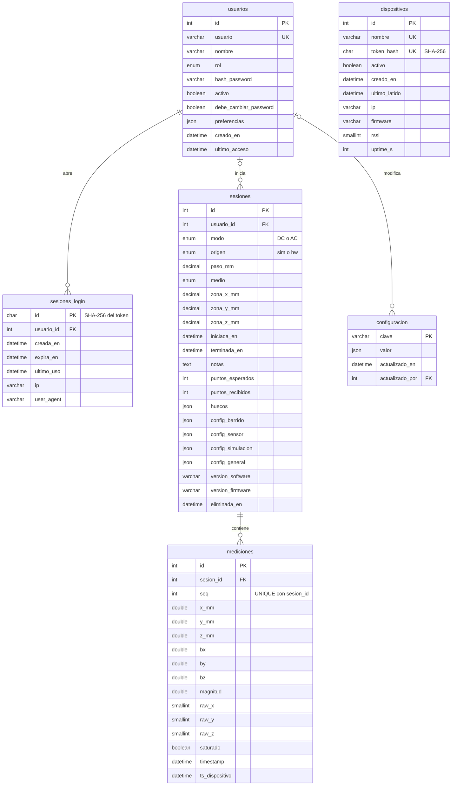

# 08 — Base de datos

Este documento describe la base de datos MariaDB del SAVD (`tms_db`): el diagrama entidad-relación, cada tabla con sus columnas, tipos, claves e índices, las decisiones de diseño (todo en UTC, DOUBLE para el campo, cuentas crudas, idempotencia por número de secuencia, JSON para las copias de configuración, borrado lógico y permisos mínimos) y las nueve migraciones que llevaron el esquema de la versión inicial al actual.

---

## 1. Motor y conexión

- **Motor:** MariaDB (11.8.6 en la computadora de desarrollo; el paquete `mariadb-server` de Raspberry Pi OS en producción), con el juego de caracteres `utf8mb4` y la intercalación `utf8mb4_unicode_ci`.
- **Conexión:** un *pool* de mysql2 con hasta 10 conexiones y una cola de hasta 100 consultas en espera. Las credenciales se leen solo de `server/.env`; si falta la contraseña, el servidor no arranca.
- **Zona horaria:** el *pool* usa `timezone: 'Z'` y cada conexión nueva ejecuta `SET time_zone = '+00:00'`, de modo que todos los `DATETIME` se escriben y se leen en UTC.

---

## 2. Diagrama entidad-relación

**Figura 8.1. Diagrama entidad-relación del esquema actual.** Las relaciones indican las claves foráneas: un usuario inicia cero o más sesiones de medición y tiene cero o más sesiones de login; cada sesión de medición contiene cero o más mediciones; un usuario puede ser el último que modificó una clave de configuración. La tabla `dispositivos` no tiene relaciones: el servidor asocia el dispositivo activo a la sesión abierta en memoria.

---

## 3. Tablas

### 3.1 `usuarios`

Personas que entran al dashboard (migración 002).

| Columna | Tipo | Nulo | Descripción |
|---|---|---|---|
| `id` | INT AUTO_INCREMENT | No | Clave primaria |
| `usuario` | VARCHAR(32) | No | Nombre de acceso, en minúsculas; único (`uq_usuarios_usuario`) |
| `nombre` | VARCHAR(100) | No | Nombre para mostrar |
| `rol` | ENUM('admin','operador','observador') | No | Rol |
| `hash_password` | VARCHAR(255) | No | `scrypt$N$r$p$salHex$hashHex` (nunca la contraseña) |
| `activo` | BOOLEAN, por defecto 1 | No | 0 = no puede entrar |
| `debe_cambiar_password` | BOOLEAN, por defecto 1 | No | 1 = debe cambiarla al entrar |
| `preferencias` | JSON | Sí | Por ejemplo, `{"tema": "oscuro"}` |
| `creado_en` | DATETIME | No | UTC |
| `ultimo_acceso` | DATETIME | Sí | UTC, último inicio de sesión correcto |

### 3.2 `sesiones_login`

Una fila por cada sesión de usuario abierta en un navegador (migración 002). Se llama así para no confundirla con `sesiones`, que son las sesiones de medición.

| Columna | Tipo | Nulo | Descripción |
|---|---|---|---|
| `id` | CHAR(64) ASCII binario | No | Clave primaria: SHA-256 hexadecimal del token de la cookie |
| `usuario_id` | INT | No | FK a `usuarios(id)` con `ON DELETE CASCADE` |
| `creada_en`, `expira_en`, `ultimo_uso` | DATETIME | No | UTC; `expira_en` se renueva con el uso (12 h) |
| `ip` | VARCHAR(45) | Sí | IPv4 o IPv6 |
| `user_agent` | VARCHAR(255) | Sí | Navegador |

Índices: `idx_sesiones_login_usuario (usuario_id)` e `idx_sesiones_login_expira (expira_en)`.

### 3.3 `sesiones`

Cada proceso de medición con sus parámetros y metadatos de reproducibilidad.

| Columna | Tipo | Nulo | Descripción |
|---|---|---|---|
| `id` | INT AUTO_INCREMENT | No | Clave primaria |
| `usuario_id` | INT | Sí | Quién la inició; FK a `usuarios(id)` con `ON DELETE SET NULL` |
| `modo` | ENUM('DC','AC') | No | Velocidad: DC rápida, AC normal |
| `origen` | ENUM('sim','hw'), por defecto 'sim' | No | Simulador del servidor o Pico W |
| `paso_mm` | DECIMAL(4,1) UNSIGNED, por defecto 5.0 | No | Paso en X, Y y Z (libre, migración 006) |
| `medio` | ENUM('campo_magnetico','solucion_salina'), por defecto 'campo_magnetico' | No | Medio (etiqueta) |
| `zona_x_mm`, `zona_y_mm`, `zona_z_mm` | DECIMAL(5,1) UNSIGNED | No | Zona de muestreo (migración 007) |
| `iniciada_en` | DATETIME | No | UTC |
| `terminada_en` | DATETIME | Sí | UTC; nulo si está abierta |
| `notas` | TEXT | Sí | Texto libre (hasta 5 000 caracteres por la API) |
| `puntos_esperados` | INT | Sí | Puntos de la malla |
| `puntos_recibidos` | INT | Sí | Filas guardadas, calculado al cerrar |
| `huecos` | JSON | Sí | `{"total": n, "posiciones": [{xMM, yMM, zMM}, …]}` (hasta 1 000) |
| `config_barrido`, `config_sensor` | JSON | Sí | Copias de la configuración al iniciar |
| `config_simulacion` | JSON | Sí | Solo en las simuladas (incluye la semilla) |
| `config_general` | JSON | Sí | Punto de inicio de la medición; solo en las reales (migración 009) |
| `version_software` | VARCHAR(64) | Sí | Versión del servidor más el commit |
| `version_firmware` | VARCHAR(40) | Sí | Firmware de la Pico (solo reales) |
| `eliminada_en` | DATETIME | Sí | Borrado lógico; nulo = visible |

Índices: `idx_sesiones_iniciada (iniciada_en)`, `idx_sesiones_filtros (modo, paso_mm, medio, origen)` para los filtros del historial e `idx_sesiones_eliminada (eliminada_en)`.

### 3.4 `mediciones`

Cada lectura vectorial (una sesión de 845 puntos con una lectura por punto tiene 845 filas).

| Columna | Tipo | Nulo | Descripción |
|---|---|---|---|
| `id` | INT AUTO_INCREMENT | No | Clave primaria |
| `sesion_id` | INT | No | FK a `sesiones(id)` con `ON DELETE CASCADE` |
| `seq` | INT | Sí | Número de lectura dentro de la sesión (nulo en las filas anteriores a la migración 004) |
| `x_mm`, `y_mm`, `z_mm` | DOUBLE | No | Posición en la zona de la sesión |
| `bx`, `by`, `bz` | DOUBLE | Sí | Componentes en µT; nulas si saturaron |
| `magnitud` | DOUBLE | Sí | $\|B\|$ en µT; nula si saturó |
| `raw_x`, `raw_y`, `raw_z` | SMALLINT | Sí | Cuentas crudas del sensor (nulas en las lecturas simuladas no saturadas) |
| `saturado` | BOOLEAN, por defecto 0 | No | 1 si la lectura saturó |
| `timestamp` | DATETIME(3) | No | Hora de recepción en el servidor (UTC, con milisegundos) |
| `ts_dispositivo` | DATETIME(3) | Sí | Hora de la lectura según la Pico (UTC, por NTP) |

Restricciones e índices: `uq_mediciones_sesion_seq UNIQUE (sesion_id, seq)` (idempotencia; también ordena el CSV) e `idx_mediciones_sesion (sesion_id)`.

### 3.5 `configuracion`

Una fila por grupo de parámetros (migración 003); el documento 07 detalla cada clave.

| Columna | Tipo | Nulo | Descripción |
|---|---|---|---|
| `clave` | VARCHAR(40) | No | Clave primaria (`general`, `modo_operacion`, `barrido`, `sensor`, `simulacion`, `dispositivo`, `visualizacion`, `datos`) |
| `valor` | JSON | No | Valor |
| `actualizado_en` | DATETIME | No | UTC |
| `actualizado_por` | INT | Sí | FK a `usuarios(id)` con `ON DELETE SET NULL`; nulo = valor por defecto |

### 3.6 `dispositivos`

Una fila por cada Pico W autorizada (migración 004). La instalación crea la fila `pico-w-1` sin token.

| Columna | Tipo | Nulo | Descripción |
|---|---|---|---|
| `id` | INT AUTO_INCREMENT | No | Clave primaria |
| `nombre` | VARCHAR(40) | No | Único |
| `token_hash` | CHAR(64) ASCII binario | Sí | SHA-256 del token; único |
| `activo` | BOOLEAN, por defecto 1 | No | 0 = la Pico recibe 401 |
| `creado_en` | DATETIME | No | UTC |
| `ultimo_latido` | DATETIME(3) | Sí | UTC |
| `ip` | VARCHAR(45) | Sí | Dirección desde la que llegó el latido |
| `firmware` | VARCHAR(40) | Sí | Versión informada |
| `rssi` | SMALLINT | Sí | dBm |
| `uptime_s` | INT UNSIGNED | Sí | Segundos encendida |

---

## 4. Decisiones de diseño

| Decisión | Motivo |
|---|---|
| **Todo en UTC** | La versión inicial guardaba las sesiones en hora local y las mediciones en UTC, y el CSV salía desfasado 6 h. Con UTC en la conexión y en la sesión de MariaDB, todos los instantes son comparables; la interfaz los muestra en la zona horaria configurada (`America/Mexico_City`). |
| **DOUBLE para posiciones y campo** | Con FLOAT (32 bits), un valor como 2,341 se leía como 2,3410000801086426. Desde la migración 005 los valores nuevos se guardan sin ese artefacto; los ya guardados conservan su error. Nunca se redondea antes de guardar: el redondeo es solo para mostrar. |
| **Cuentas crudas guardadas** | Permiten recalcular los µT si cambia la calibración (el *offset*) y auditar la conversión. SMALLINT cubre las cuentas de 16 bits del QMC5883P. |
| **`UNIQUE(sesion_id, seq)`** | Hace idempotente la ingesta: la Pico puede reenviar un lote sin duplicar filas. MariaDB admite varios nulos en un índice único, por lo que las filas antiguas sin `seq` no estorban. |
| **JSON para copias de configuración y huecos** | Las copias conservan exactamente la configuración con que se midió cada sesión sin multiplicar columnas, y su estructura puede evolucionar (por ejemplo, el cambio de HMC5883L a QMC5883P) sin migrar las sesiones viejas. Los huecos se guardan como objeto con su total para no perderlo si hay más de 1 000. |
| **Borrado lógico** | Una sesión eliminada por error se puede restaurar; el borrado definitivo queda fuera de la API. |
| **Hash de los tokens** | Tanto el token de sesión de usuario como el del dispositivo se guardan como SHA-256: leer la base no da credenciales utilizables. |
| **Usuario de la aplicación con permisos mínimos** | `tms_user` solo tiene `SELECT, INSERT, UPDATE, DELETE` sobre `tms_db`; los cambios de esquema (migraciones) se ejecutan como `root`. La contraseña se elige al instalar y solo vive en `server/.env`. |
| **`ON DELETE` cuidadosos** | Borrar un usuario no borra sus sesiones de medición (`SET NULL`), pero sí sus sesiones de login (`CASCADE`); borrar una sesión (solo por SQL) borra sus mediciones. |

---

## 5. Migraciones

Las migraciones son archivos SQL numerados en `server/migrations/`, con comentarios que explican qué hacen y cómo ejecutarlas. Se ejecutan **una sola vez, en orden y como `root`** (`sudo mysql tms_db < archivo.sql`). Todas son idempotentes salvo la 001. Una instalación limpia con `setup_db.sql` queda igual que una base antigua con todas las migraciones aplicadas (se comparó tabla por tabla).

| Migración | Fase / fecha | Qué hace |
|---|---|---|
| `001_sesiones_hora_local_a_utc.sql` | Fase 1, 9 nov 2026 | Convierte a UTC las fechas de las sesiones creadas antes del cambio (suma 6 h, la diferencia de la Ciudad de México sin horario de verano desde octubre de 2022), solo para las anteriores a una fecha de corte. No es idempotente; su ejecución en la base local quedó a decisión del tesista y no se ha aplicado. |
| `002_usuarios.sql` | Fase 2, 9 nov 2026 | Crea `usuarios` y `sesiones_login`. |
| `003_configuracion.sql` | Fase 3, 10 nov 2026 | Crea `configuracion` con los valores por defecto y añade a `sesiones` las columnas `origen`, `paso_mm` (entonces 5, 10 o 20) y `medio`, más el índice de filtros. Las sesiones existentes quedan como simuladas, de 5 mm y de campo magnético. |
| `004_dispositivo.sql` | Fase 4, 10 nov 2026 | Crea `dispositivos` (fila `pico-w-1` sin token) y añade a `mediciones` `seq`, `raw_x/y/z`, `saturado`, `ts_dispositivo` y el índice único `(sesion_id, seq)`; las componentes y el módulo pasan a admitir nulos. |
| `005_trazabilidad.sql` | Fase 5, 10 nov 2026 | Pasa las columnas numéricas de `mediciones` de FLOAT a DOUBLE y añade a `sesiones` los metadatos de reproducibilidad (`usuario_id`, `notas`, puntos esperados y recibidos, `huecos`, copias de configuración, versiones, `eliminada_en`); rellena los puntos de las sesiones existentes. |
| `006_paso_libre.sql` | 10 nov 2026 | `sesiones.paso_mm` pasa de TINYINT a DECIMAL(4,1): paso libre con un decimal. |
| `007_zona_muestreo.sql` | 10 nov 2026 | Añade `zona_x_mm`, `zona_y_mm` y `zona_z_mm` (las sesiones existentes quedan con toda la placa con que se midieron) y convierte la clave `barrido` de placa cuadrada (`grid_size_mm`, `z_max_mm`) a límites por eje. |
| `008_sensor_qmc5883p.sql` | 12 nov 2026 | Cambia el valor de `configuracion.sensor` a QMC5883P en 30 G, conservando las lecturas por punto y el *offset*. No toca tablas ni datos. |
| `009_inicio_medicion.sql` | 13 nov 2026 (sin registrar en git) | Añade la clave `general` (punto de inicio en el origen) y la columna `sesiones.config_general`. No cambia datos. |

**Estado en la base local de desarrollo** (comprobado con consultas `SELECT` el 14 de noviembre de 2026): el esquema incluye las columnas de las migraciones 006 (`paso_mm` DECIMAL(4,1)), 007 (zona) y 009 (`config_general`), y la configuración del sensor es QMC5883P (008). Es decir, de la 002 a la 009 están aplicadas; la 001 no.

---

## 6. Contenido de la base local (14 de noviembre de 2026)

| Concepto | Valor |
|---|---|
| Sesiones | 55 (33 simuladas y 22 reales), ninguna abierta ni eliminada |
| Mediciones | 27 583 (25 265 simuladas y 2 318 reales) |
| Lecturas saturadas | 92, todas en sesiones reales |
| Usuarios | 3 (uno por rol) |
| Dispositivos | 1 (`pico-w-1`) |

El documento 14 desglosa estas cifras por sesión.

---

## Fuentes en el proyecto

- `server/setup_db.sql`, `server/tests/setup_test_db.sql`
- `server/migrations/001_sesiones_hora_local_a_utc.sql` a `009_inicio_medicion.sql`
- `server/config/database.js`, `server/models/*.js`
- `COMANDOS.md` (sección 3)
- Base de datos local `tms_db`: `information_schema.COLUMNS` y conteos (consultas `SELECT` del 14 de noviembre de 2026)
