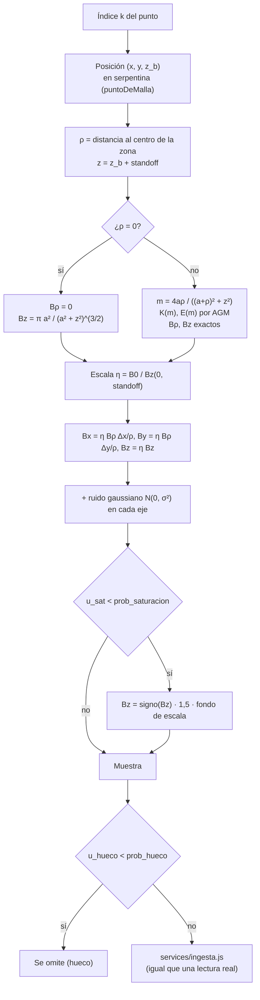

# 09 — Modelo físico y simulación

Este documento describe el simulador que corre en el servidor del SAVD: el modelo físico del campo de una espira circular con integrales elípticas completas, su cálculo por la media aritmético-geométrica, la normalización al campo en el centro y el *standoff*, el paso de coordenadas cilíndricas a cartesianas, el generador pseudoaleatorio con semilla, el ruido gaussiano, la inyección de huecos y saturaciones, el ritmo por punto y la reproducibilidad, y cómo se verificó. El simulador permite probar todo el sistema (ingesta, almacenamiento, difusión, interfaz y exportación) sin hardware.

---

## 1. Modelo de la espira circular

### 1.1 Planteamiento

Se modela la bobina como una **espira circular** de radio $a$, en el plano $z = 0$, centrada en el eje $z$ y recorrida por una corriente $I$. Por simetría, en coordenadas cilíndricas $(\rho, \varphi, z)$ el campo no depende de $\varphi$ y solo tiene componente radial $B_\rho$ y axial $B_z$.

| Símbolo | Significado | Unidades |
|---|---|---|
| $a$ | Radio de la espira (`radio_bobina_mm`, 25 mm por defecto) | mm |
| $\rho$ | Distancia del punto al eje de la espira | mm |
| $z$ | Altura del punto sobre el plano de la espira | mm |
| $\mu_0$ | Permeabilidad magnética del vacío ($4\pi \times 10^{-7}$) | T·m/A |
| $I$ | Corriente en la espira | A |
| $K(m)$, $E(m)$ | Integrales elípticas completas de primera y segunda especie | adimensionales |
| $m = k^2$ | Parámetro de las integrales elípticas | adimensional |

### 1.2 Componentes del campo

Con el parámetro

$$m = k^2 = \frac{4 a \rho}{(a + \rho)^2 + z^2}$$

y la constante $C = \mu_0 I / (2\pi)$, las componentes exactas son (Jackson; Smythe, *Static and Dynamic Electricity*):

$$B_z = \frac{C}{\sqrt{(a+\rho)^2 + z^2}}\left[ K(m) + \frac{a^2 - \rho^2 - z^2}{(a - \rho)^2 + z^2}\, E(m) \right]$$

$$B_\rho = \frac{C\, z}{\rho \sqrt{(a+\rho)^2 + z^2}}\left[ -K(m) + \frac{a^2 + \rho^2 + z^2}{(a - \rho)^2 + z^2}\, E(m) \right]$$

En el eje ($\rho = 0$) se usa el límite exacto, que evita la división entre cero:

$$B_\rho = 0, \qquad B_z = C\,\frac{\pi a^2}{(a^2 + z^2)^{3/2}} = \frac{\mu_0 I a^2}{2\,(a^2 + z^2)^{3/2}}$$

El único punto singular es el propio hilo ($\rho = a$, $z = 0$); el simulador nunca llega a él porque la altura real siempre incluye el *standoff* (sección 1.4).

### 1.3 Cálculo de $K(m)$ y $E(m)$ por la media aritmético-geométrica (AGM)

Para $m \in [0, 1)$, se definen las sucesiones:

$$a_0 = 1,\qquad b_0 = \sqrt{1 - m},\qquad c_0 = \sqrt{m}$$

$$a_{n+1} = \frac{a_n + b_n}{2},\qquad b_{n+1} = \sqrt{a_n b_n},\qquad c_{n+1} = \frac{a_n - b_n}{2}$$

que convergen de forma cuadrática al límite común $a_N$. Entonces:

$$K(m) = \frac{\pi}{2 a_N}, \qquad E(m) = K(m)\left(1 - \sum_{n=0}^{N} 2^{\,n-1} c_n^2\right)$$

La iteración se detiene cuando $|c_n| \le \varepsilon\, a_n$, con $\varepsilon$ el épsilon de la máquina en doble precisión, o tras 50 iteraciones; en la práctica bastan cinco o seis. Un valor de $m$ fuera de $[0, 1)$ provoca un error de rango.

### 1.4 Normalización y *standoff*

El simulador no usa valores físicos de $I$: trabaja con $C = 1$ (unidades arbitrarias) y escala el resultado para que el módulo del campo **en el centro de la zona, en el plano $z = 0$ del barrido**, valga el parámetro `campo_centro_ut` ($B_0$, 120 µT por defecto).

El ***standoff*** $s$ (`standoff_mm`, 5 mm por defecto) es la separación física entre la bobina y el elemento sensor: el plano $z = 0$ del barrido está a una altura $s$ sobre la espira. La altura real de un punto del barrido con altura $z_b$ es, por tanto, $z = z_b + s$.

El factor de escala es:

$$\eta = \frac{B_0}{B_z^{(C=1)}(\rho = 0,\ z = s)}$$

y el campo simulado en el punto es $\eta$ veces el campo calculado con $C = 1$ en $(\rho, z_b + s)$.

### 1.5 Paso a coordenadas cartesianas

La zona de muestreo va **centrada bajo la bobina**: el eje de la espira está en $(x_c, y_c) = (L_x/2,\ L_y/2)$, donde $L_x$ y $L_y$ son la anchura y la profundidad de la zona. Para un punto $(x, y, z_b)$ de la zona:

$$\Delta x = x - x_c,\qquad \Delta y = y - y_c,\qquad \rho = \sqrt{\Delta x^2 + \Delta y^2}$$

$$B_x = \eta\, B_\rho\,\frac{\Delta x}{\rho},\qquad B_y = \eta\, B_\rho\,\frac{\Delta y}{\rho},\qquad B_z = \eta\, B_z^{(C=1)}(\rho,\ z_b + s)$$

con $B_x = B_y = 0$ en el eje. $B_\rho$ apunta hacia afuera del eje, y su reparto entre X e Y sigue el ángulo del punto.

Con los valores por defecto ($a = 25$ mm, $s = 5$ mm, $B_0 = 120$ µT), el campo cerca del hilo en el plano $z = 0$ llega a unos 213 µT. Por eso, cuando el sensor configurado era un HMC5883L, el rango por defecto se fijó en 1,9 Ga (fondo de escala de 249,6 µT): con 1,3 Ga (187,8 µT) se perdían 4 de los 845 puntos por saturación. Con el QMC5883P en 30 G (3 276,7 µT) ningún punto simulado satura salvo que se inyecte.

**Figura 9.1. Cálculo de una muestra simulada.**

---

## 2. Generación de números aleatorios

### 2.1 Generador uniforme con semilla (mulberry32)

El simulador usa el generador **mulberry32**, con un estado de 32 bits y un periodo de $2^{32}$, suficiente para las miles de muestras de una sesión. En cada llamada, el estado aumenta en la constante 0x6D2B79F5 (módulo $2^{32}$) y se mezcla con tres rondas de desplazamientos, operaciones XOR y multiplicaciones enteras de 32 bits; el resultado, dividido entre $2^{32}$, es un número uniforme en $[0, 1)$. Con la misma semilla se obtiene exactamente la misma secuencia.

### 2.2 Ruido gaussiano (Box–Muller)

A partir de dos uniformes $u_1 \in (0, 1]$ y $u_2 \in [0, 1)$ se obtienen dos normales estándar independientes:

$$z_0 = \sqrt{-2 \ln u_1}\, \cos(2\pi u_2), \qquad z_1 = \sqrt{-2 \ln u_1}\, \sin(2\pi u_2)$$

La primera se devuelve y la segunda se guarda para la siguiente llamada. El ruido de cada eje es $\sigma z$, con $\sigma$ = `ruido_sigma_ut` (0,25 µT por defecto). Se usa $u_1 = 1 - u$ para evitar $\ln 0$.

### 2.3 Determinismo por punto

Cada punto consume **siempre cinco números** del generador, en este orden: uno para decidir el hueco, uno para la saturación y tres para el ruido de los tres ejes (aunque el punto sea un hueco). Así, con la misma semilla, el ruido de un punto no depende de las probabilidades configuradas, y la secuencia completa se repite exactamente.

---

## 3. Inyección de huecos y saturaciones

| Parámetro | Por defecto | Efecto |
|---|---|---|
| `prob_hueco` | 0 | Con probabilidad $p_h$, el punto se omite: no se envía a la ingesta y quedará como hueco al cerrar la sesión. Los huecos del simulador no dejan saltos en `seq`. |
| `prob_saturacion` | 0 | Con probabilidad $p_s$, se reemplaza $B_z$ por $\operatorname{signo}(B_z) \cdot 1{,}5 \cdot B_{fs}$, donde $B_{fs}$ es el fondo de escala del sensor configurado (3 276,7 µT con el QMC5883P en 30 G; 249,6 µT con el HMC5883L en 1,9 Ga). La ingesta la guarda como la guardaría con el sensor real: con el QMC5883P, saturada con las tres componentes nulas y las cuentas recortadas a 16 bits; con el HMC5883L, con $B_z$ nulo y la cuenta −4096. |

Estas opciones sirven para comprobar que el servidor, el cálculo de huecos, el historial y las gráficas manejan bien los datos incompletos.

---

## 4. Ritmo y ejecución

- El ritmo por punto depende de la velocidad elegida para la sesión: `ms_por_punto.DC` (60 ms) para la velocidad rápida y `ms_por_punto.AC` (120 ms) para la normal. Las sesiones simuladas guardadas midieron 0,066 s por punto en DC y 0,126 s en AC, incluido el tiempo de guardado.
- El simulador usa un **`setTimeout` encadenado**: el siguiente punto se programa cuando el anterior ya se guardó, así no se acumulan puntos si la base de datos va lenta.
- Recorre la malla en el mismo **orden de serpentina** que la Pico W.
- Cada muestra pasa por el **mismo servicio de ingesta** que las lecturas reales: validación de la posición, numeración de `seq`, saturación, cálculo de $|B|$, guardado y difusión.
- Al recorrer toda la malla, registra cuántos huecos, saturadas y rechazadas hubo y cierra la sesión con el motivo `completa`. Si alguien cierra la sesión entre dos puntos, el simulador se detiene.

---

## 5. Reproducibilidad

Al crear una sesión simulada, el servidor guarda en `sesiones.config_simulacion` una copia de toda la configuración de simulación (incluida la semilla), y en `config_barrido` y `config_sensor` las de la base y del sensor. El simulador usa **esas copias**, no la configuración vigente, así que:

- un cambio de configuración durante el barrido no altera la sesión en curso;
- una sesión simulada se puede reproducir exactamente con la misma semilla y la misma configuración;
- el CSV de la sesión incluye la configuración de simulación en su encabezado.

---

## 6. Verificación

| Verificación | Resultado | Estado |
|---|---|---|
| Campo en el eje contra la fórmula analítica $B_z = \mu_0 I a^2 / (2(a^2 + z^2)^{3/2})$, y propiedades de las integrales elípticas | Pruebas unitarias de `simulador.test.js` (12 pruebas, aprobadas el 14 de noviembre de 2026) | **Verificado** |
| Determinismo: misma semilla → misma secuencia; el ruido no depende de las probabilidades | Pruebas unitarias | **Verificado** |
| CSV de una sesión simulada con semilla fija contra el generador ejecutado aparte | Coincide con tolerancia de $10^{-9}$ (prueba de integración, aprobada según la documentación contra una MariaDB temporal) | **Verificado** |
| Saturación inyectada con el QMC5883P: `saturado = 1`, componentes nulas, crudos de 16 bits | Prueba de integración | **Verificado** |
| Barridos completos de 845, 147 y 32 puntos, con huecos al 5 % | Comprobado con `curl` y en el navegador (Fases 3 y 5); 33 sesiones simuladas en la base local | **Verificado** |

La física del simulador es la misma para los dos medios (campo magnético y solución salina con voltaje); si la solución salina debe simularse con otra física sigue siendo una cuestión abierta (documento 17).

---

## Fuentes en el proyecto

- `server/services/fisicaEspira.js`, `server/services/aleatorio.js`, `server/services/simulacionPura.js`, `server/services/simulador.js`
- `server/services/ingesta.js`, `server/services/geometria.js`, `server/services/validacionConfiguracion.js`
- `server/tests/simulador.test.js`, `server/tests/integracion/api.integ.js`
- Bitácora de desarrollo del proyecto (notas de las Fases 3 y 5)
- Base de datos local `tms_db`: ritmo de las sesiones simuladas
