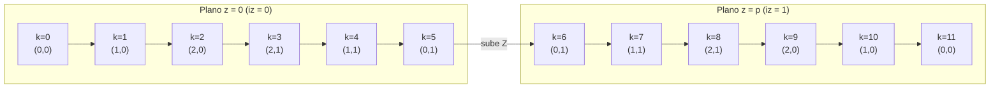

# 10 — Geometría de la malla

Este documento describe cómo se construye la malla de puntos de cada sesión de medición: la zona de muestreo, el paso libre en milímetros (igual en X, Y y Z), los límites de la base, el número de puntos por eje y de planos, el total de puntos, el límite por sesión y las tolerancias. Describe también el recorrido en serpentina y la correspondencia entre el índice de un punto y su posición, que es idéntica en el servidor, el simulador, el emulador de la Pico, el firmware y la interfaz.

---

## 1. Zona de muestreo y límites de la base

Cada sesión tiene su **zona de muestreo**: un prisma de $L_x \times L_y \times L_z$ milímetros que el operador elige al iniciarla (con un decimal, y con un botón «Toda la base»). Las coordenadas de la zona van de 0 a $L_x$ en X, de 0 a $L_y$ en Y y de 0 a $L_z$ en Z, donde $z = 0$ es el plano más cercano a la bobina (a la distancia del *standoff*).

La zona no puede superar los **límites de la base**, que un administrador configura en Configuración › Barrido (`limite_x_mm`, `limite_y_mm`, `limite_z_mm`): por defecto 60 × 60 × 20 mm, el tamaño de la placa del montaje original. Si se cambia de base, se cambian los límites; en la base local de desarrollo están en 400 × 500 × 60 mm para las pruebas en la mesa real. Una zona fuera de los límites responde 422.

- En el **simulador**, la zona va centrada bajo la bobina (el eje de la espira está en $L_x/2$, $L_y/2$).
- En la **mesa real**, el punto (0, 0, 0) de la zona se coloca en el **punto de inicio de la medición** y la zona crece en X+, Y+ y Z+ (documento 05). Los límites físicos de la mesa (410, 562 y 88 mm) los valida la Pico.

---

## 2. Paso de medición

El paso $p$ es **libre**, en milímetros, con un decimal como máximo, y se aplica **igual en X, Y y Z**. Sus límites son:

| Límite | Valor | Motivo |
|---|---|---|
| Mínimo | 1 mm | El posicionamiento tiene un error objetivo de ±1 mm; un paso menor no aporta información |
| Máximo | 300 mm | Tope de validación |
| Decimales | 1 | Las posiciones se redondean a décimas de milímetro |
| Puntos por sesión | 25 000 como máximo | Tope para que la interfaz pueda dibujar todos los puntos |

Los pasos de 5, 10 y 20 mm son solo **sugerencias**; en el panel del dashboard el paso se escribe en un campo con un botón de 5 mm al lado. El paso predeterminado es configurable (`paso_predeterminado_mm`, 5 mm por defecto).

---

## 3. Número de puntos

El número de puntos a lo largo de un eje de longitud $L$ con paso $p$ es:

$$n(L, p) = \left\lfloor \frac{L}{p} + \varepsilon \right\rfloor + 1$$

con $\varepsilon = 10^{-6}$, una tolerancia que evita errores de coma flotante cuando $p$ divide exactamente a $L$. Las posiciones son:

$$q_i = \operatorname{redondeo}_{0{,}1}(i \cdot p), \qquad i = 0, 1, \dots, n - 1$$

redondeadas a décimas de milímetro, porque $i \cdot 0{,}1$ no da un valor exacto en coma flotante. **Si el paso no divide la zona, el último punto queda antes del borde.**

Entonces:

$$n_x = n(L_x, p),\qquad n_y = n(L_y, p),\qquad n_z = n(L_z, p)$$

$$N = n_x \cdot n_y \cdot n_z$$

| Símbolo | Significado |
|---|---|
| $n_x$, $n_y$ | Puntos por fila en X y por columna en Y (`grid_nx`, `grid_ny`) |
| $n_z$ | Número de planos Z (`z_levels_mm` = 0, $p$, $2p$, … hasta $L_z$) |
| $N$ | Puntos de la sesión (`puntos_esperados`) |

### 3.1 Ejemplos con la base de 60 × 60 × 20 mm

| Paso | Malla X-Y | Planos Z (mm) | Puntos por sesión |
|---|---|---|---|
| 5 mm (0,5 cm) | 13 × 13 | 0, 5, 10, 15, 20 | **845** |
| 7,5 mm | 9 × 9 | 0, 7,5, 15 | 243 |
| 10 mm (1 cm) | 7 × 7 | 0, 10, 20 | 147 |
| 20 mm (2 cm) | 4 × 4 | 0, 20 | 32 |

En el ejemplo de 7,5 mm, $60/7{,}5 = 8$ da 9 puntos por eje, pero $20/7{,}5 \approx 2{,}67$ da 3 planos: el último plano queda en 15 mm, antes del borde de 20 mm. Con 7 mm también resultan 243 puntos (9 × 9 × 3).

### 3.2 Ejemplos con zonas usadas en la mesa real

| Zona (mm) | Paso | Malla | Puntos | Sesiones reales |
|---|---|---|---|---|
| 40 × 40 × 10 | 10 mm | 5 × 5 × 2 | 50 | 59 |
| 50 × 50 × 20 | 10 mm | 6 × 6 × 3 | 108 | 65, 66, 67 |
| 20 × 20 × 20 | 10 mm | 3 × 3 × 3 | 27 | 69 |
| 50 × 50 × 30 | 10 mm | 6 × 6 × 4 | 144 | 74 |
| 50 × 50 × 50 | 10 mm | 6 × 6 × 6 | 216 | 62, 64, 72, 73 |
| 50 × 50 × 30 | 3 mm | 17 × 17 × 11 | 3 179 | 75 (interrumpida en 484) |
| 100 × 100 × 60 | 10 mm | 11 × 11 × 7 | 847 | 60 (interrumpida en 232) |

---

## 4. Tolerancias

| Uso | Tolerancia | Dónde |
|---|---|---|
| Número de puntos por eje y comparación de posiciones | $10^{-6}$ mm | `services/geometria.js` y `frontend/src/utils/geometria.js` |
| Validación de que $z$ coincide con un plano de la sesión | $10^{-6}$ mm | Ingesta (`indicePlano`) |
| Validación de que $x$ e $y$ caen dentro de la zona | $10^{-6}$ mm | Ingesta |
| Una lectura cubre un punto de la malla al calcular huecos | 1 mm en X y en Y (requisito de error posicional) | `services/trazabilidad.js` |
| La zona cabe en la mesa desde el punto de inicio | $10^{-6}$ mm | Firmware (`errores_de_zona`) |

---

## 5. Recorrido en serpentina

### 5.1 Descripción

La malla se recorre en **serpentina continua**: X avanza hasta el máximo, Y sube un paso y X regresa midiendo, y así hasta terminar el plano; Z sube un paso y el plano siguiente se recorre **desde donde quedó la mesa** (Y también va y viene). Entre dos puntos consecutivos solo cambia un índice en ±1, lo que minimiza los desplazamientos de la mesa y evita los regresos largos de un recorrido fila por fila.

### 5.2 Correspondencia índice → posición

Sea $k \in \{0, \dots, N-1\}$ el índice del punto en el recorrido. Sus índices de malla $(i_x, i_y, i_z)$ son:

$$i_z = \left\lfloor \frac{k}{n_x n_y} \right\rfloor,\qquad r = k \bmod (n_x n_y),\qquad f = \left\lfloor \frac{r}{n_x} \right\rfloor$$

$$i_y = \begin{cases} f & \text{si } i_z \text{ es par} \\ n_y - 1 - f & \text{si } i_z \text{ es impar} \end{cases}$$

$$g = i_z\, n_y + f$$

$$i_x = \begin{cases} r \bmod n_x & \text{si } g \text{ es par} \\ n_x - 1 - (r \bmod n_x) & \text{si } g \text{ es impar} \end{cases}$$

donde $f$ es la fila dentro del plano y $g$ el número global de fila (contando todas las filas de todos los planos ya recorridos). La posición del punto es $(x_{i_x},\ y_{i_y},\ z_{i_z})$, con las posiciones de la sección 3.

### 5.3 Correspondencia posición → índice (inversa)

$$f = \begin{cases} i_y & \text{si } i_z \text{ es par} \\ n_y - 1 - i_y & \text{si } i_z \text{ es impar} \end{cases},\qquad g = i_z\, n_y + f$$

$$c = \begin{cases} i_x & \text{si } g \text{ es par} \\ n_x - 1 - i_x & \text{si } g \text{ es impar} \end{cases},\qquad k = g \cdot n_x + c$$

Un punto fuera de la malla devuelve −1.

### 5.4 Vector de prueba del contrato

Con $n_x = 3$, $n_y = 2$ y dos planos ($k = 0 \dots 11$), los índices $(i_x, i_y, i_z)$ son:

(0,0,0) (1,0,0) (2,0,0) (2,1,0) (1,1,0) (0,1,0) (0,1,1) (1,1,1) (2,1,1) (2,0,1) (1,0,1) (0,0,1)

**Figura 10.1. Recorrido en serpentina de una malla de 3 × 2 con dos planos.** Cada nodo es un punto (índices $i_x$, $i_y$); las flechas siguen el orden del recorrido. El paso del plano 0 al plano 1 se hace en vertical, sin mover X ni Y.

### 5.5 Dónde se usa el mismo contrato

| Componente | Implementación |
|---|---|
| Servidor (malla, huecos) | `indicesDeSerpentina`, `serpentinaDeIndices`, `puntoDeMalla` e `indiceDeMalla` en `server/services/geometria.js`; los huecos se listan en este orden |
| Simulador | Recorre los índices $k = 0 \dots N-1$ con `puntoDeMalla` |
| Emulador de la Pico | Mismo `puntoDeMalla` |
| Firmware de la Pico | `barrido.indices` y `barrido.punto` en `firmware/barrido.py` |
| Interfaz | `indiceEnMalla` en `frontend/src/utils/geometria.js`: el eje X de la gráfica de líneas es el índice $k$ del punto |

La ingesta y el cálculo de huecos **no dependen del orden**: el servidor valida cada lectura por su posición y su `seq`, de modo que acepta cualquier recorrido. Por eso el firmware del Hall 49E, que recorre fila por fila (X, luego Y, luego Z), funciona con el mismo servidor.

### 5.6 Relación con el número de secuencia

Con una lectura por punto, $\text{seq} - 1 = k$. Con $N_L$ lecturas por punto, la lectura con número $s$ es la lectura $(s - 1) \bmod N_L$ del punto $k = \lfloor (s-1)/N_L \rfloor$. Esta relación es la que permite a la Pico reanudar exactamente en `ultimo_seq + 1`.

### 5.7 Verificación

| Verificación | Estado |
|---|---|
| Vector del contrato 3 × 2 × 2, ida y vuelta con un solo plano, casos $n_y = 1$ y $n_x = 1$ (pruebas unitarias del servidor) | **Verificado** |
| Mismo conjunto de puntos en el firmware y en el servidor, vector del contrato y vecinos ±1 (pruebas del firmware en la computadora) | **Solo simulación/PC** |
| Recorrido real en la mesa con el firmware `pico-tms-2.0` (sesiones 67 a 74) | **Verificado** |
| Gráfica de líneas sin cortes falsos: en una simulación de 147 puntos, índice = `seq` − 1 en todos | **Verificado** |

La prueba del firmware que compara con el servidor todavía verifica el **conjunto** de puntos y no la secuencia punto por punto (el orden se verifica aparte con el vector del contrato); compararlos uno a uno es una mejora posible.

---

## Fuentes en el proyecto

- `server/services/geometria.js`, `server/config/barrido.js`, `server/services/trazabilidad.js`, `server/services/conversionSensor.js`
- `frontend/src/utils/geometria.js`
- `firmware/barrido.py`, `firmware_hall_1d/barrido.py`, `firmware/pruebas_pc/prueba_logica.py`
- `docs/firmware-pico-w.md` (sección 7)
- `server/tests/simulador.test.js`
- Base de datos local `tms_db`: zonas y pasos de las sesiones reales
