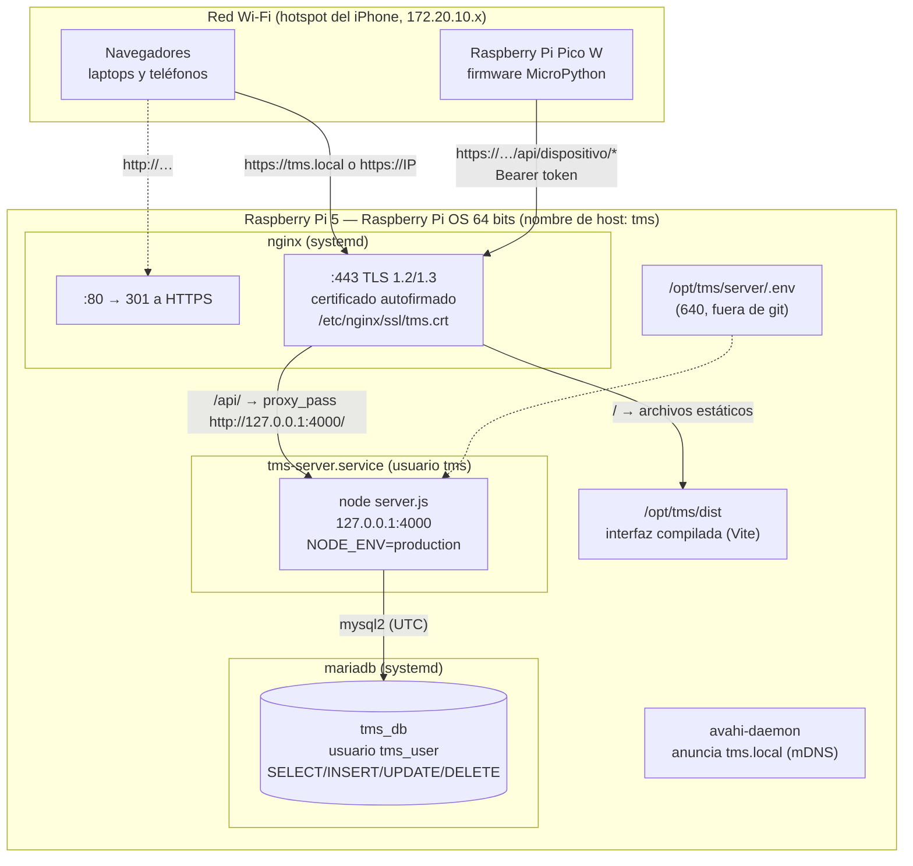

# 13 — Despliegue e infraestructura

Este documento resume cómo se instala y opera el SAVD en la Raspberry Pi 5 (según la guía de instalación del proyecto): paquetes del sistema, base de datos, backend como servicio de systemd, compilación de la interfaz, Nginx como proxy inverso con HTTPS, acceso desde el hotspot por IP o por el nombre `tms.local`, la configuración de la Pico W, las comprobaciones finales, los respaldos y las diferencias entre el entorno de desarrollo y el de producción. Incluye un diagrama de despliegue.

---

## 1. Diagrama de despliegue

**Figura 13.1. Despliegue en producción.** La Raspberry Pi 5 aloja los tres servicios; el proyecto vive en `/opt/tms`. Solo Nginx escucha en la red (puertos 80 y 443); Node.js escucha en la interfaz local y MariaDB en su puerto local.

---

## 2. Instalación en la Raspberry Pi 5

La guía `COMANDOS.md` deja el sistema funcionando en una Raspberry Pi 5 limpia con Raspberry Pi OS de 64 bits. Resumen de sus pasos:

| Paso | Qué se hace |
|---|---|
| 1. Paquetes | Actualizar el sistema e instalar `git`, `curl`, `mariadb-server`, `nginx`, `openssl` y `avahi-daemon`; instalar **Node.js 20 LTS** desde NodeSource (el de los repositorios puede ser más antiguo); habilitar MariaDB y Nginx al arrancar. |
| 2. Proyecto | Copiar el proyecto a `/opt/tms` con `git clone` o con `rsync` (sin `node_modules`, `.env` ni `dist`). |
| 3. Base de datos | Instalación limpia: reemplazar la contraseña de ejemplo en `setup_db.sql` y ejecutarlo como `root` (crea la base, el usuario con permisos mínimos, las seis tablas, la configuración por defecto y la fila de la Pico). Si se viene de una versión anterior, ejecutar las migraciones que falten, en orden y como `root`, después de un respaldo. |
| 4. Backend | Crear `server/.env` a partir de `.env.example` con `HOST=127.0.0.1`, `NODE_ENV=production` y las credenciales de la base; permisos 600 (después 640 para el usuario del servicio); `npm ci --omit=dev` (solo dependencias de producción). |
| 5. Administrador | Crear el usuario administrador con el script `crear-admin` (documento 12). Los demás usuarios se crean desde la interfaz. |
| 6. Interfaz | En `frontend/`, `npm ci` y `npm run build`: Vite compila a `/opt/tms/dist`, que es exactamente la raíz que sirve Nginx. Las fuentes, Bootstrap y los iconos van empaquetados: no se necesita internet. |
| 7. Certificado | Generar un certificado autofirmado RSA de 2 048 bits y 10 años en `/etc/nginx/ssl/` con `openssl`. |
| 8. Nginx | Copiar `nginx/tms.conf` **tal cual** a `sites-available`, enlazarlo en `sites-enabled`, quitar el sitio `default`, comprobar con `nginx -t` y recargar. |
| 9. Servicio | Crear el usuario de sistema `tms` (sin *shell* ni carpeta personal), dar acceso de lectura al `.env`, copiar `deploy/tms-server.service` a `/etc/systemd/system/`, habilitarlo e iniciarlo. El registro se consulta con `journalctl -u tms-server -f`. |
| 10. Acceso | Configurar el nombre de host y el acceso desde el hotspot (sección 4). |
| 11. Pico W | Generar el token desde la interfaz y configurar la Pico (sección 5). |
| 12. Comprobaciones | `curl -k https://tms.local/api/status`, inicio de sesión con `curl`, una sesión simulada de 2 cm (32 puntos) y la prueba en el navegador. |
| 13. Respaldos | Ver la sección 6. |

Para actualizar el código: `git pull`, `npm ci --omit=dev` en `server/`, `npm ci && npm run build` en `frontend/`, las migraciones nuevas si las hay y `systemctl restart tms-server`.

---

## 3. Componentes del servidor

### 3.1 Nginx (`nginx/tms.conf`)

La configuración de Nginx es una restricción fija del proyecto: se copia tal cual y no se modifica.

| Bloque | Función |
|---|---|
| `server` en el puerto 80 | Redirección 301 a HTTPS |
| `server` en el puerto 443 | TLS 1.2 y 1.3 con cifrados fuertes, caché de sesiones TLS, cabeceras de seguridad (HSTS, `X-Frame-Options`, `nosniff`, `X-XSS-Protection`, `Referrer-Policy`) |
| `root /opt/tms/dist` | Sirve la interfaz compilada, con compresión gzip y caché de un año para los recursos con huella (JS, CSS, fuentes, imágenes) |
| `location /api/` | `proxy_pass http://127.0.0.1:4000/` (quita el prefijo `/api`), HTTP/1.1, cabeceras `X-Real-IP`, `X-Forwarded-For` y `X-Forwarded-Proto`, sin *buffering* ni caché y con tiempos de espera de 24 h para que el canal SSE no se corte |
| `location /` | `try_files … /index.html`: la aplicación de una sola página resuelve sus rutas |
| `location ~ /\.` | Deniega los archivos ocultos (404) |
| Registros | `/var/log/nginx/tms_access.log` y `tms_error.log` |

El nombre de servidor configurado es `tms.ipn.local`, pero como Nginx es el único servidor en el puerto 443, responde por HTTPS con cualquier nombre o IP.

### 3.2 Servicio de systemd (`deploy/tms-server.service`)

| Directiva | Valor |
|---|---|
| Dependencias | Después de `network-online.target` y `mariadb.service` |
| Usuario y grupo | `tms` |
| Directorio y variables | `/opt/tms/server`, con `EnvironmentFile=/opt/tms/server/.env` |
| Comando | `/usr/bin/node server.js` |
| Reinicio | `Restart=on-failure`, cada 5 s |
| Git | Añade `/opt/tms` a `safe.directory` para que la versión del software incluya el commit aunque el usuario `tms` no sea el dueño del repositorio |
| Endurecimiento | `NoNewPrivileges`, `PrivateTmp`, `ProtectSystem=strict`, `ProtectHome`, `ProtectKernelTunables`, `ProtectControlGroups`, `RestrictSUIDSGID` |

Al arrancar, el registro debe mostrar la conexión a MariaDB, la configuración cargada y `Servidor 3.0.0+<commit> escuchando en http://127.0.0.1:4000 (production)`. Si falta una migración, el servidor se detiene indicando cuál ejecutar.

---

## 4. Acceso desde el hotspot

`tms.conf` usa `server_name tms.ipn.local`, pero ese nombre no se resuelve solo: mDNS (Avahi) solo anuncia nombres de una etiqueta, como `raspberrypi.local`, y `tms.ipn.local` tiene dos. Las opciones comprobadas con Nginx y una copia de `tms.conf` son:

1. **Nombre `.local` con mDNS (recomendada).** Se cambia el nombre de host de la Raspberry a `tms` y se entra a `https://tms.local` desde laptops (macOS, Windows 10 o posterior, Linux con Avahi) y desde teléfonos iPhone o Android recientes. Sigue funcionando aunque el hotspot cambie la IP.
2. **Por IP.** `https://<IP>` funciona con cualquier IP, porque `tms.conf` es el único servidor en el puerto 443. Por HTTP, el sitio `default` de Raspberry Pi OS capturaría `http://<IP>`; por eso la guía lo deshabilita. La IP se consulta con `hostname -I` y puede cambiar entre sesiones.

---

## 5. Configuración de la Pico W para el servidor

1. Un administrador pone el sistema en modo **Real** (menú lateral) y genera el token en Configuración › Dispositivo.
2. En la Pico, `secretos.py` lleva el nombre y la contraseña de la red, el token y la dirección del servidor (`https://tms.local` o la IP, en producción; `http://<IP de la laptop>:4000`, en desarrollo).
3. Sin hardware, el emulador prueba el mismo protocolo: `npm run emular-pico -- --token <TOKEN> --url https://tms.local/api --insecure --perdida 0.3 --duplicar 0.2`.

---

## 6. Respaldo y restauración de la base

- **Respaldo**, sin detener el servicio: `mysqldump --single-transaction --routines tms_db`, comprimido con gzip y con la fecha en el nombre.
- **Restauración**: con el backend detenido, se carga el volcado en `tms_db` y se vuelve a iniciar el servicio.
- **Borrado definitivo** de sesiones eliminadas (la API solo hace borrado lógico): la guía documenta la consulta SQL para borrar las sesiones eliminadas hace más de 30 días, después de un respaldo.
- Antes de aplicar las migraciones 004, 005 y 009 en la base de desarrollo se guardó un respaldo previo (de la base completa o de las tablas afectadas), según la bitácora de desarrollo.

---

## 7. Desarrollo frente a producción

| Aspecto | Desarrollo (computadora del tesista) | Producción (Raspberry Pi 5) |
|---|---|---|
| Interfaz | Servidor de Vite en `http://localhost:5173`, con recarga en caliente | Archivos compilados en `/opt/tms/dist`, servidos por Nginx |
| API | Proxy de Vite `/api` → `127.0.0.1:4000` (ruta completa) | Nginx `/api/` → `127.0.0.1:4000/` (sin el prefijo) |
| Backend | `npm run dev` (nodemon); `NODE_ENV=development` | `node server.js` como servicio de systemd; `NODE_ENV=production` |
| Escucha del backend | `127.0.0.1`, o `HOST=0.0.0.0` para que la Pico lo alcance por la red (el script `dev.sh` abre dos terminales: backend escuchando en toda la red e interfaz) | Solo `127.0.0.1` |
| Pico W | `http://<IP de la laptop>:4000` | `https://tms.local` o `https://<IP>` |
| Cookie | Sin `Secure` (funciona por HTTP) | Con `Secure` (solo HTTPS) |
| Errores | Incluyen detalles internos | Sin detalles internos |
| CORS | Necesario para el origen de Vite | No interviene (mismo origen) |
| Dependencias | Incluye nodemon y Vite | `npm ci --omit=dev` en el servidor; Vite solo para compilar |
| Pruebas sin conflicto | Un segundo servidor en otro puerto (`PORT=4100`) y una base de pruebas (`tms_db_test`) | — |

### 7.1 Estado del despliegue

| Elemento | Estado |
|---|---|
| Servidor, interfaz y base en la computadora de desarrollo, usados con la mesa real | **Verificado** |
| Despliegue de producción probado sin privilegios de administrador en la computadora de desarrollo: `npm ci --omit=dev`, compilación a `<raíz>/dist`, servidor en producción y Nginx con una **copia** de `tms.conf` en puertos altos (HTTPS por IP y por `.local`, redirección, cookie `Secure` y SSE) | **Solo simulación/PC** |
| Instalación en la Raspberry Pi 5 con la guía | **Pendiente** |

Si `/opt/tms` no es un repositorio de git (por ejemplo, si se copió con `rsync`), la versión del software aparece como `3.0.0+desconocido`.

---

## Fuentes en el proyecto

- `COMANDOS.md` (secciones 1 a 15)
- `nginx/tms.conf` (solo lectura), `deploy/tms-server.service`, `dev.sh`
- `server/server.js`, `server/app.js`, `server/.env.example`, `server/setup_db.sql`, `server/services/version.js`
- `frontend/vite.config.js`
- `docs/firmware-pico-w.md` (secciones 3 y 6), `firmware/README.md` (sección 9)
- Bitácora de desarrollo del proyecto (notas de la Fase 8)
