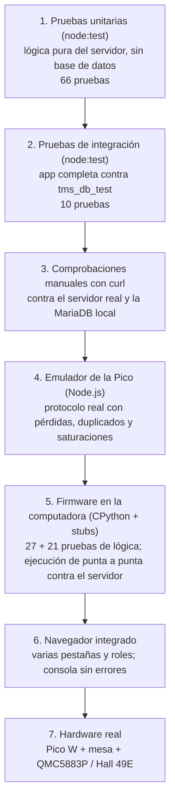

# 14 — Pruebas y verificación

Este documento describe la estrategia de pruebas del SAVD y sus resultados: las pruebas unitarias y de integración del servidor (con las cifras obtenidas al ejecutarlas el 14 de noviembre de 2026), el emulador de la Pico W, las pruebas del firmware en una computadora, la verificación en el navegador, la revisión de diseño y accesibilidad, y las pruebas con el hardware real. Termina con una tabla de qué se verificó, cómo y con qué resultado, la lista de lo que falta probar y las estadísticas de las sesiones guardadas en la base de datos local.

---

## 1. Estrategia

La verificación se organizó en capas, de la lógica pura al sistema completo con hardware:

**Figura 14.1. Capas de verificación.**

Criterios:

- La lógica pura (geometría, conversión, física, aleatoriedad, trazabilidad, validadores, contraseñas) vive en módulos que no importan la conexión a la base, para poder probarla sin infraestructura.
- Las pruebas de integración nunca tocan la base de producción: el auxiliar de pruebas impide usar `tms_db` y exige `tms_db_test`.
- Cada cambio relevante se verificó con al menos una de estas capas antes de darse por terminado, y las sesiones de prueba creadas en la base local se borraron después.

---

## 2. Pruebas unitarias del servidor

Se ejecutan con `cd server && npm test` (`node --test`, que encuentra los archivos `*.test.js`). **Resultado del 14 de noviembre de 2026: 66 pruebas, 66 aprobadas, 0 fallidas, en 0,5 s.**

| Archivo | Pruebas | Qué cubre |
|---|---|---|
| `conversion.test.js` | 12 | Conversión de cuentas a µT para varias ganancias del HMC5883L y los cuatro rangos del QMC5883P; $\|B\|$ sin redondear; −4096 como saturación (HMC5883L) o como cuenta válida (QMC5883P); el bit `saturado`; resta del *offset*; rechazo de crudos, `seq`, posición y hora inválidos; conversión inversa; detección de lotes con apariencia de cuentas HMC |
| `ingesta-dispositivo.test.js` | 7 | Idempotencia: lote nuevo, reenvío completo (todo duplicado), lote solapado, `seq` repetido dentro del lote, lectura inválida que no tumba el lote, pérdidas y reintentos (al final cada `seq` una sola vez), `saturado` no booleano |
| `passwords.test.js` | 7 | Formato del hash y sal distinta cada vez, verificación correcta e incorrecta, hashes mal formados, longitudes, la excepción de la cuenta predeterminada, límite de intentos y su limpieza |
| `simulador.test.js` | 12 | $K(m)$ y $E(m)$ contra valores de referencia; $B_z$ en el eje contra la fórmula analítica (error menor que $10^{-9}$); $\|B\|$ en el centro igual a `campo_centro_ut`; $B_\rho = 0$ en el eje; simetría; determinismo de la semilla; σ empírica de 100 000 muestras a menos del 2 % de la configurada; mallas de 845, 147 y 32 puntos en serpentina; vector del contrato; fondo de escala del QMC5883P; saturaciones inyectadas; ningún punto saturado con 1,9 Ga y 4 con 1,3 Ga |
| `trazabilidad.test.js` | 12 | Puntos esperados según el paso; paso libre (7 y 2,5 mm); zona rectangular de 40 × 20 × 10 mm; huecos (malla completa, posiciones faltantes en orden, tolerancia de 1 mm, corte de la lista en 1 000); encabezado y filas del CSV; nombre del archivo; búfer de eventos del SSE |
| `validadores.test.js` | 16 | Todos los validadores de entrada (400, 422, 403 y 404), la configuración del sensor de los dos modelos, la clave `general` y el punto de inicio en el latido |

La documentación de la Fase 8 registraba 53 pruebas unitarias; las posteriores (paso libre, zona, QMC5883P, serpentina y punto de inicio) llevaron el total a las 66 actuales.

---

## 3. Pruebas de integración del servidor

Se ejecutan con `npm run test:integracion`, que levanta la aplicación en un puerto aleatorio contra **`tms_db_test`**, vacía sus tablas y crea un usuario de cada rol. Hay **10 pruebas** (nueve declaradas, una de ellas repetida para los dos modelos de sensor):

1. Sesión simulada con semilla fija: el CSV coincide con el simulador ejecutado aparte (tolerancia $10^{-9}$).
2. y 3. Pico emulada con QMC5883P y con HMC5883L, con pérdidas, duplicados y saturadas: los `seq` quedan sin huecos ni duplicados, en serpentina.
4. Punto de inicio de la medición: 409 con una sesión abierta, latido con la copia de la sesión y línea en el CSV.
5. Simulador con QMC5883P: las saturadas quedan con `saturado = 1`, sin componentes y con crudos de 16 bits.
6. Roles: 401 sin sesión y 403 con un rol insuficiente.
7. Paso libre: 12,5 mm guarda la malla correcta y se puede filtrar.
8. Zona de 40 × 20 × 10 mm con paso de 10 mm: 30 puntos dentro de la zona, y los límites de la base se respetan.
9. Borrado lógico y restauración.
10. 409 por sesión doble y por cambiar el modo con una sesión abierta.

**Estado:** según la documentación del proyecto, las 10 pasaron (la última vez, el 14 de noviembre de 2026) contra una MariaDB temporal levantada sin privilegios de administrador en la computadora de desarrollo. No se volvieron a ejecutar para este informe, porque requieren una base de pruebas que el procedimiento vacía.

---

## 4. Emulador de la Pico W

`npm run emular-pico` emula la Pico con el mismo protocolo (latido y lotes), recorre la malla en serpentina con lecturas crudas verosímiles (la misma física de espira que el simulador) en el formato del modelo de sensor de la sesión, y reenvía cada lote fallido con los mismos `seq`. Opciones: tamaño del lote, ritmo de lectura, probabilidad de perder un lote (la mitad de las veces no se envía y la otra mitad se envía pero se ignora la respuesta, lo que fuerza reintentos y duplicados), probabilidad de reenviar un lote ya confirmado, probabilidad de saturación, corte de latidos a los N segundos, semilla y aceptación del certificado autofirmado.

Resultado documentado en la Fase 4: con una pérdida del 30 % y duplicados, una sesión de 147 puntos terminó con los 147 `seq` sin huecos ni duplicados. En fases posteriores se repitió con zonas rectangulares, paso de 7,5 mm y los dos modelos de sensor.

---

## 5. Pruebas del firmware en la computadora

- **`firmware/pruebas_pc/prueba_logica.py`: 27 pruebas, todas aprobadas el 14 de noviembre de 2026** (en unos 15 s). Cubren la rampa y la codificación para el PIO, la malla y la serpentina, la reanudación, la mesa y los límites, el orden de los ejes, la holgura, el sensor QMC5883P falso (identificación, otros chips, rangos, promedio, DRDY, OVFL, `OSError`, fondo), los dos formatos de envío y el búfer.
- **`firmware_hall_1d/pruebas_pc/prueba_logica.py`: 21 pruebas, todas aprobadas el 14 de noviembre de 2026.**
- **Ejecución de punta a punta** (`ejecutar_pc.py`, firmware real en CPython contra el servidor real y una base temporal), según la documentación:

| Fecha | Escenario | Resultado |
|---|---|---|
| 11 nov 2026 | Firmware del Hall: 50 puntos; Ctrl+C a mitad del barrido | Sin huecos; $B_z$ guardado igual al medido salvo el paso de las cuentas (38,47 → 38,41 mT); regreso al origen |
| 12 nov 2026 | Firmware principal, modo cuentas HMC: 12 puntos (3 × 2 × 2) | Orden exacto del contrato |
| 12 nov 2026 | 147 puntos con Ctrl+C a mitad de un movimiento, caída de Wi-Fi, reanudación y 3 % de OVFL | 147 `seq` sin huecos ni duplicados; saturadas con −4096; regreso al origen |
| 12 nov 2026 | Modo QMC5883P con 3 lecturas por punto | 441 `seq` = 147 × 3 en el orden del contrato, µT exactos, saturadas con `saturado = 1` |
| 12 nov 2026 | 401 a mitad del barrido | Regreso al origen |
| 13 nov 2026 | Punto de inicio (100, 300, 50) enviado por el servidor; 147 puntos con interrupción, reanudación y 2 % de OVFL | Destinos de máquina en los intervalos esperados; regreso a la posición de descanso |
| 13 nov 2026 | Zona que no cabe desde (540, 410, 88) | Rechazada sin mover nada; aviso en el dashboard |
| 14 nov 2026 | Descanso en (0, 562, 88), inicio (0, 0, 0), X+, Y+, Z+: 147 puntos de 60 × 60 × 20 con paso de 10 mm | Destinos X 0–60, Y 0–60, Z 0–20 y regreso al descanso; zona que no cabe desde X = 380 rechazada |

La última posición de descanso del código, (0, 0, 0), se fijó después de esa prueba del 14 de noviembre; las 27 pruebas de lógica pasan con ella, pero no hay una ejecución de punta a punta documentada con ese valor.

---

## 6. Verificación en el navegador

En cada fase se verificó la interfaz en el navegador integrado del entorno de desarrollo, con el backend y Vite en marcha y la consola sin errores. Entre otras cosas:

- Inicio de sesión, cambio forzado de contraseña y permisos por rol (administrador, operador y observador).
- Barridos simulados de 845, 147 y 32 puntos visibles a la vez en **dos pestañas**; recarga a mitad del barrido (se dibujan todos los puntos anteriores y el porcentaje del plano es exacto); reconexión del SSE.
- Historial: filtros (incluida una condición de carrera al cambiar varios filtros seguidos, encontrada y corregida al verificar), notas, eliminar con modal, ver eliminadas y restaurar, CSV.
- Configuración: todas las secciones como administrador y como observador (solo lectura), los dos modelos de sensor y el punto de inicio.
- Firmware real ejecutado en la computadora con la interfaz: indicador «en línea · midiendo», aviso de zona fuera del recorrido y «Detener» con regreso a la posición de descanso.
- Sábana 3D: magnitudes, exportación SVG y PNG, giro durante el barrido y la sábana de una sesión real desde el historial (sesión 74).
- Tiempo estimado: estimación previa en modo real (0,96 s por punto con 17 sesiones) y cuenta atrás en una simulación de 845 puntos.
- Rendimiento: ninguna tarea larga (más de 50 ms) en el hilo principal durante un barrido de 845 puntos a 20 ms por punto.

---

## 7. Revisión de diseño y accesibilidad

En la Fase 7 se revisó la interfaz contra las pautas de interfaces web (salida archivo por archivo con su línea), se hizo un plan de diseño, se corrigió y se repitió la revisión. Se calculó el contraste de cada par texto/fondo de los dos temas con la fórmula de luminancia relativa de WCAG 2.1 (mínimo 4,5:1): todos los colores usados como texto lo cumplen; los dos tokens que no lo alcanzan se reservaron para bordes, iconos y fondos. No se ejecutaron Lighthouse ni axe porque no se pudieron instalar en el entorno; quedan como mejora.

---

## 8. Pruebas con el hardware real

Según las sesiones guardadas y la confirmación del tesista:

| Prueba | Sesiones | Resultado | Estado |
|---|---|---|---|
| Firmware del Hall 49E con la mesa | 59 a 65 (11 nov 2026 por la tarde, hora local) | Barridos completos de 50, 216, 216 y 108 puntos (59, 62, 64, 65); 60, 61 y 63 interrumpidas. El tesista confirma resultados correctos | **Verificado** |
| Firmware principal `pico-tms-2.0` con el QMC5883P en modo de cuentas HMC | 66 | 108 puntos; 85 saturadas por el límite de ±249,6 µT por eje de ese formato (el mayor $\|B\|$ válido fue 308,7 µT, con cada componente por debajo del límite); muestra por qué hacía falta el modo QMC | **Verificado** |
| Firmware principal `pico-tms-2.0` con el QMC5883P en modo QMC (30 G) | 67, 69, 72, 73, 74 | Barridos completos de 108, 27, 216, 216 y 144 puntos; la mesa se movió bien; hasta 2 876,6 µT con 5 y 2 saturadas en 67 y 69 (imán cercano) | **Verificado** |
| Paso fino de 3 mm (3 179 puntos) | 75 | 484 puntos, interrumpida por el operador | **Verificado** (parcial, a propósito) |
| Cierre automático al completar la malla | 67, 69, 72, 73, 74 | Cerradas solas con todos sus puntos | **Verificado** |
| Calibración de 50 pulsos/mm | — | Cada eje avanza la distancia pedida (cualitativo) | **Verificado** (sin medición numérica del error) |
| Firmware `pico-tms-2.1` y `2.2` (punto de inicio, ejes, descanso) | 76 a 82 | Recorridos de 0 a 25 puntos, interrumpidos a propósito por el tesista para comprobar el arranque | **Solo simulación/PC**, con pruebas cortas en la mesa |

### 8.1 Lo que falta probar con el hardware

- Un barrido completo con la versión vigente del firmware (`pico-tms-2.2`, con la posición de descanso del código y el punto de inicio enviado por el servidor).
- La medición numérica del error posicional (requisito de ±1 mm), la repetibilidad ida y vuelta y la calibración de la holgura con un calibrador.
- Un barrido de 845 puntos completo con el QMC5883P.
- La operación con la Raspberry Pi 5 como servidor, a través de Nginx con HTTPS.
- El acceso simultáneo de varios dispositivos a través del hotspot del iPhone.
- La resolución de `tms.local` desde la Pico W.

---

## 9. Estadísticas de la base de datos local

Obtenidas el 14 de noviembre de 2026 con consultas `SELECT` sobre `tms_db`.

### 9.1 Resumen

| Concepto | Simuladas (`sim`) | Reales (`hw`) | Total |
|---|---|---|---|
| Sesiones | 33 (19 DC, 14 AC) | 22 (todas DC) | 55 |
| Primera / última | 12 jun 2026 / 14 nov 2026 | 12 nov 2026 / 14 nov 2026 | — |
| Lecturas | 25 265 | 2 318 | 27 583 |
| Saturadas | 0 | 92 | 92 |
| Pasos usados | 5 mm (29), 10 mm (3), 20 mm (1) | 10 mm (21), 3 mm (1) | — |
| Ritmo por punto | 0,066 s (DC, 60 ms configurados); 0,126 s (AC, 120 ms) | 0,73–1,05 s (QMC5883P); 0,84–0,95 s (Hall) | — |

Las fechas están en UTC. Las sesiones simuladas de junio corresponden a la primera versión del sistema (simulación en el navegador).

### 9.2 Sesiones reales

$|B|$ en µT tal como se guardó (en las sesiones del Hall, el número corresponde a mT; documento 04). El ritmo se calcula con la hora de la Pico entre la primera y la última lectura.

| Sesión | Firmware | Modelo | Zona (mm) | Esperados | Recibidos | Saturadas | Huecos | s/punto | $\|B\|$ mín–máx |
|---|---|---|---|---|---|---|---|---|---|
| 59 | hall1d-0.1 | HMC5883L | 40 × 40 × 10 | 50 | 50 | 0 | 0 | 0,84 | 0,00–0,12 |
| 60 | hall1d-0.1 | HMC5883L | 100 × 100 × 60 | 847 | 232 | 0 | 615 | 0,95 | 0,00–0,12 |
| 61 | hall1d-0.1 | HMC5883L | 50 × 50 × 50 | 216 | 12 | 0 | 204 | 0,78 | 0,00–0,12 |
| 62 | hall1d-0.1 | HMC5883L | 50 × 50 × 50 | 216 | 216 | 0 | 0 | 0,93 | 0,00–0,12 |
| 63 | hall1d-0.1 | HMC5883L | 50 × 50 × 50 | 216 | 83 | 0 | 133 | 0,95 | 0,00–0,12 |
| 64 | hall1d-0.1 | HMC5883L | 50 × 50 × 50 | 216 | 216 | 0 | 0 | 0,89 | 0,00–7,44 |
| 65 | hall1d-0.1 | HMC5883L | 50 × 50 × 20 | 108 | 108 | 0 | 0 | 0,94 | 0,00–0,73 |
| 66 | 2.0 | HMC5883L | 50 × 50 × 20 | 108 | 108 | 85 | 85 | 0,78 | 38,06–308,66 |
| 67 | 2.0 | QMC5883P | 50 × 50 × 20 | 108 | 108 | 5 | 5 | 0,98 | 71,43–2 876,62 |
| 69 | 2.0 | QMC5883P | 20 × 20 × 20 | 27 | 27 | 2 | 2 | 1,05 | 46,56–2 447,27 |
| 71 | 2.0 | QMC5883P | 50 × 50 × 50 | 216 | 49 | 0 | 167 | 0,73 | 189,40–272,99 |
| 72 | 2.0 | QMC5883P | 50 × 50 × 50 | 216 | 216 | 0 | 0 | 0,77 | 148,24–334,80 |
| 73 | 2.0 | QMC5883P | 50 × 50 × 50 | 216 | 216 | 0 | 0 | 0,74 | 67,91–167,13 |
| 74 | 2.0 | QMC5883P | 50 × 50 × 30 | 144 | 144 | 0 | 0 | 0,77 | 125,99–236,35 |
| 75 | 2.0 | QMC5883P | 50 × 50 × 30 (paso 3) | 3 179 | 484 | 0 | 2 695 | 0,59 | 146,71–185,05 |
| 76 | 2.0 | QMC5883P | 50 × 50 × 50 | 216 | 5 | 0 | 211 | 0,69 | 175,95–176,50 |
| 77 | 2.1 | QMC5883P | 50 × 50 × 40 | 180 | 19 | 0 | 161 | 0,73 | 161,19–176,61 |
| 78 | 2.1 | QMC5883P | 50 × 50 × 50 | 216 | 0 | — | 216 | — | — |
| 79 | 2.2 | QMC5883P | 50 × 50 × 50 | 216 | 0 | — | 216 | — | — |
| 80 | 2.2 | QMC5883P | 50 × 50 × 50 | 216 | 0 | — | 216 | — | — |
| 81 | 2.2 | QMC5883P | 50 × 50 × 50 | 216 | 25 | 0 | 191 | 0,73 | 85,88–86,68 |
| 82 | 2.2 | QMC5883P | 50 × 50 × 50 | 216 | 0 | — | 216 | — | — |

Observaciones:

- En las sesiones del Hall, los valores de 0,00 a 0,12 corresponden a cero o una cuenta (0,12 mT), es decir, al ruido del sensor sin un imán cerca; la 64 y la 65 registran un campo de hasta 7,44 mT y 0,73 mT.
- En las sesiones del QMC5883P, $|B|$ incluye el fondo (el *offset* configurado era 0), por lo que los valores mínimos de decenas a cientos de µT reflejan el campo terrestre, el entorno y la fuente de campo usada en cada prueba; los máximos de miles de µT corresponden a un imán cercano.
- El ritmo de 0,59 s por punto de la sesión 75 corresponde al paso de 3 mm, con desplazamientos más cortos.
- Ninguna sesión real tiene más de una lectura por punto.

---

## Fuentes en el proyecto

- `server/tests/*.test.js`, `server/tests/integracion/api.integ.js`, `server/tests/integracion/helper.js`
- `server/scripts/emular-pico.js`
- `firmware/pruebas_pc/`, `firmware_hall_1d/pruebas_pc/`
- `firmware/README.md` (sección 11), `firmware_hall_1d/README.md` (sección 8)
- `docs/fase7-revision-diseno.md`
- Bitácora de desarrollo del proyecto (verificaciones de cada fase)
- Ejecución de `npm test` y de las pruebas del firmware el 14 de noviembre de 2026
- Base de datos local `tms_db` (consultas `SELECT` del 14 de noviembre de 2026)
